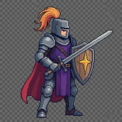
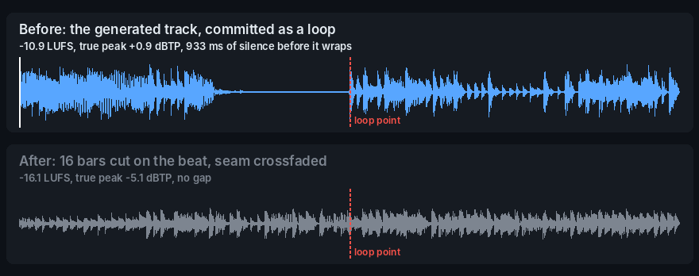
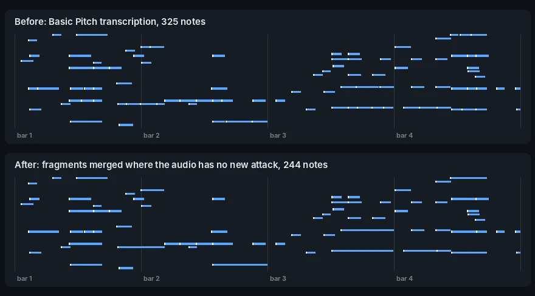

# slop-gate

<p align="center">
  
</p>

A reusable GitHub Actions workflow that blocks pull requests containing the
patterns AI tools leave behind: stock phrasing in docs and PR text, swallowed
errors and truncation markers in code, hidden Unicode, and broken image and
audio assets. It checks only the lines a PR changes, posts one report comment
that it rewrites on every push, and never commits to the branch. The PR author
reads the report, fixes the findings, pushes, and the check runs again.

## Add it to a repo

1. Copy [`examples/.github/workflows/slop-gate.yml`](examples/.github/workflows/slop-gate.yml)
   into the repo's `.github/workflows/`.
2. Optional: copy [`examples/.slop-gate.yml`](examples/.slop-gate.yml) to the repo
   root and trim it. Without it, the defaults apply and media gets only the
   universal checks.
3. In the branch ruleset for `main`, require the `slop-gate / slop-gate` status
   check.

Consumer repos call the workflow at `@v1`, a release branch that moves
forward only to a commit whose CI passed on `main`. A rule change here reaches
consumers when `v1` moves; pin a commit SHA instead to control that yourself.

## See it work

Each clip below is a recording of slop-gate running, not a mock-up. The
browser clips are from [PR #11](https://github.com/mikejmckinney/slop-gate/pull/11),
a demo PR on this repo with deliberate slop in its first commit. How they were
made, and how to re-record them, is in [`docs/media/src`](docs/media/src).

### A PR from blocked to green

The report lands as one comment with a fix for each row: prose in the new
page and the PR description, and lint findings in the new script. The author
rewrites the flagged lines and pushes; the same comment turns green. The
reviewer on that PR, another agent, also caught a bug no rule covers: the
script left plain files in `.cache/` behind. slop-gate is a filter in front of
review, not a replacement for it.


### Hidden characters and generation residue

`billing.py` looks clean in review. slop-gate finds a zero-width space inside
a string, a right-to-left override in a comment, a Cyrillic letter posing as
the `a` in `paid`, a truncation marker, pasted assistant text and a swallowed
exception. The fixed file passes.


### Only the lines a PR changes, or the whole repo

Old slop on `main` doesn't block a PR that leaves it alone: the check reports
only the two findings on the PR's new line. `check --all` reads every line,
which is what the `slop-audit` workflow runs before a cleanup.


### Tool footers removed from comments

A comment posted from a Claude Code cloud session arrives with a footer. The
footer workflow edits it out within seconds, and the comment shows "edited by
github-actions".


## Before and after

Each example is a model's real output, the report slop-gate wrote about it,
and the version that passed. The fixes follow the reports' fix text; slop-gate
never edits a file itself. Prompts, scripts and the full reports are in
[`docs/media/src/before-after`](docs/media/src/before-after).

### Writing

Asked for a "Why sfxpack?" README section for a made-up tool that prepares
sound effects for Unity and Godot, `gemini-2.5-flash` wrote:

<!-- vale off -->
> Working with sound effects in game development often involves repetitive,
> time-consuming tasks. You’ve got a folder of WAVs, but Unity wants OGG and
> Godot prefers OGG or even WAV, each with specific import settings. Before
> that, you’re manually normalizing loudness to ensure a consistent audio
> experience, then meticulously trimming silence from the beginning and end of
> each file. This isn't just tedious; it's a bottleneck that pulls focus from
> creative work.
>
> **sfxpack** automates this entire pipeline. It streamlines your workflow by
> taking a raw folder of WAVs and, in one command, converts them to the correct
> formats for your chosen engine, ensures consistent loudness through LUFS
> normalization, and trims unnecessary silence. […]

| | Line | Rule | Problem and fix |
|---|---|---|---|
| 🛑 | 3 | `SlopGate.ContrastFormula` | 'This isn't just tedious; it's' is a contrast formula. State the true claim once. |
| ⚠️ | 3 | `SlopGate.AIVocabulary` | 'meticulously' is inflated vocabulary. Use the word you'd say out loud. |
| ⚠️ | 5 | `SlopGate.CorporateVerbs` | 'streamlines' names no concrete action. Say what was done to what, or cut the sentence. |
<!-- vale on -->

The rewrite passes with no findings:

> A folder of raw WAV effects needs three passes before it goes into a game:
> convert each file to the format Unity or Godot expects, bring every file to
> the same loudness, and cut the silence at the start and end. sfxpack runs all
> three over the whole folder in one command, with the loudness target set in
> LUFS, so a new batch of effects doesn't mean opening each file in an audio
> editor.

The rules catch phrasing, not facts. "Unity wants OGG" passed, though Unity
[imports WAV directly](https://docs.unity3d.com/2022.3/Documentation/Manual/AudioFiles.html);
checking claims is still the reviewer's job.

### Pixel-art sprite

Five image models got the same prompt: "A 32x32 pixel art sprite of a knight
with a sword and shield, facing right, for a retro 2D game. 16-color palette,
1-pixel dark outline, hard edges, no anti-aliasing, transparent background."
The manifest says what the game needs:

```yaml
- glob: "assets/sprites/**/*.png"
  size: "32x32"
  pixel_art: true
  max_colors: 16
  alpha: required
```

None of the five delivered it; the gate reported 16 blocking findings.

| Model | Output | Findings |
|---|---|---|
| `gpt-image-2.5-sunburst` |  | 1024×1024, 52,461 colors, 328,245 semi-transparent pixels: the knight itself is at alpha 252–254, slightly see-through in a game |
| `gemini-3-pro-image` |  | 1024×1024, 65,818 colors, no transparency: the checkerboard is painted in |
| `gemini-3.1-flash-image` |  | 1024×1024, 65,759 colors, painted checkerboard |
| `mai-image-2.5-pro` |  | 1024×1024, 77,346 colors, painted checkerboard |
| `seedream-5-0-pro` |  | 2048×2048, 96,519 colors, painted checkerboard, and JPEG data in a `.png` file (the API returned JPEG) |

The sunburst knight was the only one with real transparency. Following the
fix text (threshold the alpha, resize to the declared size, quantize to 16
colors with no dithering) gives a sprite that passes with no findings:


A pixel artist would still tidy single-pixel clusters by hand, as the fix text
says; the gate checks the format, not the drawing.

### Image review (advisory)

The [vision review](#vision-review-advisory) asked for "exactly four identical
glowing floor lamps arranged in a 2 by 2 grid". One image in the bakeoff was
made with a fifth lamp; its twin has four.

| Image | What the review said |
|---|---|
|  | Fail from both models in every run that completed (one `gemini-4-argon` run errored). `claude-opus-5.5`: "There are five glowing lamps, three in the top row and two in the bottom row, but the spec requires exactly four." |
|  | Pass from both models with no findings, in both runs. |

### Game music loop

The same brief went to Mureka and Suno, two takes each: "Looping background
music for a top-down arena bomber game … 120 BPM, instrumental, no vocals, no
intro, no fade-out." Checked against a manifest rule with `loop: true` and
`loudness_lufs: -16`, all four fail:

| Take | Length | Loudness | True peak | Silence at the wrap | Listening review |
|---|---|---|---|---|---|
| Mureka 9.5 A | 2:45 | −10.8 LUFS | +1.0 dBTP | 928 ms at the end | Nothing |
| Mureka 9.5 B | 2:56 | −10.1 LUFS | +0.4 dBTP | 180 ms at the start | An impact sound after the fade-out; the levels agree: a fade, then a jump 6 s before the end |
| Suno A | 2:36 | −13.7 LUFS | −1.7 dBTP | 17 ms at each end | A fade to silence at 2:28, then a drum fill. Not in the audio: the last 8 s stay within 2 dB of the track's average level |
| Suno B | 2:33 | −13.4 LUFS | −1.3 dBTP | 17 ms at the start | Nothing |

Each take is a full-length track whose end doesn't meet its start. One
listening finding was invented, which is why the review never blocks. The Suno
takes came back as MP3 and Mureka's also as FLAC; the loop is re-encoded for
the game anyway, so the lossless source decided it, and the loop below is cut
from Mureka A. Musical quality wasn't judged here.

Committed as Ogg Vorbis with nothing else changed, Mureka A blocks on three
findings:

<!-- vale off -->
| | Rule | Problem and fix |
|---|---|---|
| 🛑 | `true-peak` | True peak +0.9 dBTP exceeds −1.0 dBTP; lossy encoding and resampling will clip it. |
| 🛑 | `loudness` | Integrated loudness −10.9 LUFS; the manifest targets −16 ±2.0. |
| 🛑 | `loop-gap` | Loop has 0 ms of silence at the start and 933 ms at the end, which plays as a gap every time it wraps. **Fix:** Trim to the musical loop points or crossfade the tail into the head before export. |
<!-- vale on -->

The fix: 16 bars cut on the tracked beats (the take runs at about 117.5 BPM,
not the 120 asked for), the audio that follows the cut crossfaded into the
loop's first 350 ms, one gain change to −16 LUFS, Ogg Vorbis. It passes with
no findings. Each row below is the last 6 seconds running into the first 6, as
the game plays them:



Listen (the files download): [before](docs/media/before-after/arena-before-wrap.ogg?raw=true),
[after](docs/media/before-after/arena-after-wrap.ogg?raw=true), or
[both as an MP4 with sound](docs/media/before-after/loop-wrap.mp4?raw=true).

Played three times in a row through the listening review, the loop drew one
finding from one model: "a brief gap" at the first join. The other model heard
nothing. The dip there is in the original track at the same point, a break
before the downbeat, so it was left alone. That is the kind of call the
advisory review leaves to a person.

### Spoken line

The transcript check compares what a model hears against a `.script.txt`
sidecar. For the listening bakeoff, `eleven_v4` read the tutorial script with
one number changed and one word dropped:

<!-- vale off -->
> Words differ from `audio/intro.script.txt` (model transcript compared in code):
>
> - after “hold to charge”: expected “then”, heard “(nothing)”
> - after “seven begins in”: expected “1250”, heard “12050”
<!-- vale on -->

Read from the real script, the words match and the diff is empty. One review
model added a low-confidence note that "each sentence rises and falls on nearly
the same curve"; the other heard nothing. In a separate test, ElevenLabs,
Gemini TTS and HeyGen each read a line with "1,250 m", "B-12" and "3:45"
correctly, and two transcriptions of each matched the script.

### MIDI

Basic Pitch's transcription of the loop above draws the `restruck-note`
warning: 26 held notes chopped into back-to-back fragments, across 12 bars.
Merging a fragment into the note before it unless that pitch shows a new attack
in the audio (a rise of 3 dB or more in its own frequency band) leaves 9 runs
in 6 bars. Each of those has a rise at its pitch, so it may be a deliberate
retrigger, and the warning now points at bars 1, 5, 7, 8, 11 and 12 to check
by ear.



## What it checks

| Family | Blocks on | Warns on |
|---|---|---|
| `prose` (Markdown, text, and comments in code) | Stock openers and closers, "it's not X, it's Y", hedging preambles, unnamed experts, inflated significance, assistant residue, unfilled placeholders, stacked buzzwords, more than two dashes per paragraph | Single inflated words, prestige labels, corporate verbs, `serves as` for `is`, trailing "-ing" commentary, filler transitions, stacked hedges, both-sides framing |
| `pr-text` (PR title, body, commits) | The prose rules above on the PR body; tool attribution footers | Attribution trailers in commits (level set by `commit_trailers`) |
| `unicode` (every changed text file) | Bidi controls, zero-width and tag characters, variation-selector runs, Latin look-alikes mixed into words, non-ASCII spaces in source code | Non-ASCII spaces in prose, markup, and data files |
| `residue` (source files) | Truncation markers (`... rest of the code`), placeholder secrets, AI banners, pasted assistant text, stub admissions | "In a real application you would…" comments |
| `ruff` (Python) | Unused imports and variables, undefined names, blind `except`, `try/except/pass`, commented-out code, mutable defaults, assign-then-return; formatting in files the PR adds (or every changed line with `ruff_format_scope: changed`) | Formatting in existing files the PR edits |
| `biome` (JS/TS) | Unused imports and variables, empty blocks such as `catch {}`, catch-and-rethrow, unreachable code | |
| `media` (images and audio) | Undecodable files, wrong format for the extension, oversized files, clipping, true peak above 0 dBTP, stereo that collapses in mono by more than 12 dB; and when the manifest declares it: size, frame grid, palette size, soft alpha in pixel art, off-grid pixels, tile seams, loudness target, loop gaps, loop clicks, level jumps at the loop point | True peak between −1 and 0 dBTP, long leading or trailing silence on one-shots, dropouts, cut-off endings, a click at the first sample, a WAV or FLAC that looks decoded from an MP3, hiss in pauses, mono loss over 6 dB; and when the manifest declares a minimum: flat dynamics |
| `midi` (`.mid`, `.midi`) | Files that don't parse | Notes that never end, overlap on one channel or have no length; a part doubled note for note on a second track with the same instrument; held notes chopped into off-grid fragments; tempo maps of many tiny changes; semitone clashes held for a sixteenth or longer |

The prose rules come from a house style table of AI-writing patterns. Each
rule in [`styles/SlopGate`](styles/SlopGate) has a fixture in
[`tests/fixtures/prose`](tests/fixtures/prose) that must trigger it, because a
Vale rule that matches nothing fails silently.

## Working with the report

The report comment groups findings by family. Each row has the file and line,
the rule id, what is wrong, and how to fix it. Errors block the merge;
warnings are advice. The same table is in the job summary, and the full list
is in the `slop-gate-findings` artifact as JSON.

Nothing here rewrites code or prose for you. Mechanical fixes are one command
(`ruff format <file>`), and the prose findings need a rewrite that a word swap
won't produce.

### Suppressing a finding

Sometimes a flagged pattern is the right call. Make that explicit in the file
so a reviewer sees it:

- **Prose in Markdown:** wrap the passage in
  `<!-- vale SlopGate.ContrastFormula = NO -->` …
  `<!-- vale SlopGate.ContrastFormula = YES -->`.
- **Residue in code:** add `slop-gate: ignore` in a comment on the same line.
  Unicode findings can't be suppressed this way, since an attacker could add
  the same comment.
- **A rule for the whole repo:** set it to `warning` or `off` under
  `overrides` in `.slop-gate.yml`.

## Media manifest

A file can't say whether it is right. `player.png` might be a 32×32 sprite
sheet in 16 colors, and `level1.ogg` might need to loop. The manifest in
`.slop-gate.yml` declares that intent with glob rules, and the media checks
compare each changed file against it. To draft one from the assets a repo
already has:

```bash
PYTHONPATH=path/to/slop-gate python -m slopgate media-init --repo .
```

The draft records what exists today. Keep the values that are intentional and
fill in the commented hints, such as which tracks loop.

For loops, prefer Ogg Vorbis or Opus. MP3 encoders pad the start and end of
the stream, and the padding plays as a gap at the loop point.

### Audio defects

The audio checks come from an antipattern list for generated music, speech and
effects, and cover the defects a measurement can find:

| Rule | Finds | Doesn't find |
|---|---|---|
| `dropout` | 20 ms or more of digital silence with sound on both sides | Quiet passages and deliberate stops at a lower level |
| `cut-off-ending` | Sound that stops within 12 dB of the file's average level, a severed tail | Loops, once the manifest says `loop: true` |
| `starts-mid-waveform` | A first sample above 5% of full scale, which clicks on playback | |
| `lossy-source` | A WAV or FLAC whose spectrum ends in a wall between 11 and 21 kHz. Usually it was decoded from an MP3 or similar, so the conversion added size and no detail; a steep low-pass filter or upsampling leaves the same wall, so check before re-exporting | Lossy files themselves, and sample rates under 32 kHz |
| `mono-collapse` | Stereo that loses more than 6 dB summed to mono (error above 12 dB), usually an inverted channel | Width that survives the mono sum |
| `hiss` | Spectrally flat noise above −72 dBFS in at least 0.3 s of pauses | Reverb tails and decays, which aren't flat |
| `flat-dynamics` | An EBU R128 loudness range under the manifest's `min_loudness_range_lu`, for tracks of 30 s or more | Anything, until you set the minimum: genres differ too much for a default |

The thresholds were tuned on 206 shipped game assets (Mureka and ElevenLabs
music and effects and a third-party effects pack). On that set the checks
reported dropouts only in a glitch effect, no lossy sources, mono collapse or
hiss, and cut-off endings on review excerpts, on a loop the manifest didn't
declare, and on four short effects (two glitches, an error sound and a reflect sound)
whose hard stops may be the design. A finding can still be intended: a glitch
effect has dropouts on purpose. Skip such a file in the manifest, or turn a
rule off for the repo under `overrides`.

Clicks in the middle of a dense mix aren't checked. A detector tried on the
same assets flagged 19 of 42 clean files and still missed most injected
clicks, so it would have taught people to ignore the report.

slop-gate doesn't try to tell whether audio, images or text were made by AI.
Detectors such as Deezer's only scan streaming playlists, their research code
is licensed for non-commercial use, and a project that generates its music on
purpose would be flagged on every track. A detector score says nothing about
what to fix; these checks do.

### MIDI

MIDI files get structural checks, aimed at what audio-to-MIDI transcription
and generators leave behind:

| Rule | Finds | Leaves alone |
|---|---|---|
| `midi-unreadable` | A file that doesn't parse (error) | |
| `hanging-note`, `overlapping-note`, `zero-length-note` | Notes with no end, a pitch restarted on its channel before it ends, notes that end on the tick they start | |
| `duplicate-notes` | Four or more notes doubled on another track with the same channel and instrument | Doubling with another instrument or octave |
| `restruck-note` | Three or more back-to-back fragments of one pitch, mostly off the sixteenth-note grid | Repeated notes on the grid, such as a pulsing bassline |
| `tempo-jitter` | Eight or more tempo changes whose median step is under 2 BPM | A handful of real tempo changes |
| `semitone-clash` | Two channels holding notes a minor second apart for a sixteenth or longer, listed by bar | Major sevenths, minor ninths, drums |

On 4 code-generated song files the checks report only semitone clashes, which
are worth a listen. On two Basic Pitch transcriptions of game tracks they
report 77 and 170 chopped held notes. A clash can be the intended color:
listen to the bars it names, and turn `semitone-clash` off under `overrides` if
the repo leans on that sound.

## Vision review (advisory)

Deterministic checks can't see six fingers, a floating character, or text on
a sign that should be blank. The optional `slop-judge` job sends each changed
image to two vision models, `anthropic/claude-opus-5.5` and
`google/gemini-4-argon`, chosen by the [bakeoff](bakeoff/judge/README.md):
together they caught 18 known defects in 33 of 36 defect-runs (two runs each)
with no false claims, at about $0.03 per image.

To use it, add an `OPENROUTER_API_KEY` repository secret, add the
`slop-judge` job from the [example workflow](examples/.github/workflows/slop-gate.yml),
and put the `slop-judge` label on a PR. While the label is on, every push
re-runs the review on the images the PR changed and updates one comment.

- **It never blocks.** Models change their verdict on 4–12% of images between
  identical runs, so the job reports and passes. A finding both models raise
  is likely real; a finding from one model is a place to look.
- **It judges against a spec when it has one.** A `<name>.prompt.txt` file next
  to the image wins, then a `spec` on the matching media manifest rule.
  Without a spec, only contradictions inside the image are checked.
- **It caps cost.** At most 20 images per run by default; set `judge.max_images`
  or `judge.models` in `.slop-gate.yml` to change that.
- **Fork PRs are skipped**, because GitHub doesn't give them repository secrets.

## Listening review (advisory)

The same `slop-judge` job also listens to the audio a PR changes. Two audio
models, `google/gemini-3.1-pro-preview` and `google/gemini-4-argon`, report
defects by time range using the pattern names from the audio antipattern list:
metallic shimmer, pitch wobble, reverb wash, voice drift, repetition without
purpose, disconnected sections and the rest. In the
[bakeoff](bakeoff/listen/README.md) the pair placed all six planted defects
and made no medium or high finding on the clean clips, at about $0.014 per
30-second clip.

- **Each finding says how it was found.** The report lists time range,
  pattern, what the model heard, its confidence with "model listening" as the
  basis, and the fix from the antipattern list. It is inference, not
  measurement and not a human listening check: listen to the range before
  acting on it.
- **It checks the words when you give it the words.** Put the script or
  lyrics in a `<name>.script.txt` or `<name>.lyrics.txt` file next to the
  audio. `thinkingmachines/inkling` transcribes the audio and the comparison is
  done in code, so "expected 1250, heard 12050" or a dropped word shows up as a
  plain diff. Chinese, Japanese and Thai, which don't put spaces between
  words, are compared character by character. Write the file as text: "1,250 m"
  and "B-12" match a narrator saying "1,250 meters" and "B12". A file longer than five minutes
  gets no diff, and the report says so, since only its start is transcribed.
- **It reads the brief.** A `<name>.prompt.txt` file or a manifest `spec`
  tells the models what the file is meant to be, so a deliberate distortion or
  a steady loop isn't reported as a defect.
- **It reads only regular files in the checkout.** Sidecars, images and audio
  reached through a symlink are ignored, so a PR can't point a sidecar at a
  file outside the repo and have it sent to the model.
- **It never blocks and it caps cost.** At most 10 audio files per run, the
  first five minutes of each. Set `judge.audio_models`,
  `judge.transcribe_model` or `judge.max_audio` in `.slop-gate.yml` to change
  that.

## Settings to pair with it

- **Attribution at the source.** In Claude Code's `.claude/settings.json`,
  `attribution.commit` and `attribution.pr` set to `""` remove the
  `Co-Authored-By` trailer and the PR footer, and `attribution.sessionUrl`
  set to `false` removes the `Claude-Session` link that cloud and Remote
  Control sessions add ([example](examples/.claude/settings.json),
  [reference](https://code.claude.com/docs/en/settings-reference#attribution-sessionurl)).
  A cloud session that clones several repositories reads only the plugin
  keys from each repo's settings file, so add a line to the repo's
  `CLAUDE.md` as well ([this repo's](CLAUDE.md)). Some Claude Code versions
  have ignored the setting, so the PR check stays as the backstop.
- **Footers you can't turn off.** Some agent tooling adds a footer to
  everything it writes through GitHub (PR descriptions, issue bodies,
  comments) and puts it back on every edit. No repo setting stops it.
  - *PR descriptions:* pass `strip-attribution-footer: true` to the gate
    workflow and it deletes footer lines (and the rule above them) before
    the check reads the description. Fork PRs are skipped, since their token
    can't edit the PR, and so are descriptions by authors without write
    access (earlier versions stripped those too).
  - *Comments and issue bodies:* copy
    [`examples/.github/workflows/slop-footer.yml`](examples/.github/workflows/slop-footer.yml).
    It strips the footer from issue and PR comments, review comments and
    issue bodies within a few seconds of each post or edit. The job installs
    nothing, so a run takes seconds.
  - *What's already there:* run the same workflow from the Actions tab. With
    `apply` off it counts, per kind, what it would change and lists every
    line it would remove, with a link to its item; with `apply` on it edits
    every PR description (open or closed), issue body and comment that has
    a footer. `python -m slopgate.footers backfill --repo owner/name`
    does the same locally through `gh`.

  In every case only a line that holds nothing but the footer is removed (a
  sentence that mentions one stays), only text by owners, members and
  collaborators is edited, slop-gate's own report comments are skipped, and a
  footer quoted inside a code fence stays. Edits made with the workflow token
  don't start new workflow runs, so nothing loops. One gap: whether editing a closed PR's
  description triggers a gate run is untested, so such a footer may stay until
  the next backfill.
- **Squash merges.** Set the repository's default squash message to "pull
  request title and description" so commit bodies, trailers included, don't
  reach the default branch.
- **Review.** Require one approving review from an account other than the
  PR author, dismiss stale approvals on new pushes, and require the
  `slop-gate` check.

## Audit a whole repo

The PR gate only looks at changed lines. To map the debt a repo already has,
copy [`examples/.github/workflows/slop-audit.yml`](examples/.github/workflows/slop-audit.yml)
into the repo and run it from the Actions tab. It checks every tracked file,
puts the report in the job summary, saves the full list as the
`slop-audit-findings` artifact (JSON and Markdown), and doesn't fail unless
you set `fail-on-errors`.

To fix what it finds:

1. Mechanical fixes, run locally and reviewed like any other diff:
   `ruff check --fix --select F401,F841,F541 .`, `ruff format .`, and
   `npx @biomejs/biome@2.6.3 lint --write --config-path <slop-gate>/configs/biome.json .`.
2. Everything else needs a person or an agent: give it `slop-audit.json`,
   one file at a time, and have it rewrite the flagged passages. Each finding
   carries the rule and the fix.
3. Re-run the audit, then turn on the PR gate so the debt doesn't come back.

Split a large cleanup into several PRs by check family (`only: prose`, then
`code`, then `media`) so each one is reviewable.

## Run it locally

Requires Python 3.13, [Vale](https://vale.sh) 3.25+, Ruff, Node (for Biome),
and ffmpeg for audio.

```bash
pip install -r requirements.txt
PYTHONPATH=. python -m slopgate check --repo ../my-repo --base origin/main --head HEAD
PYTHONPATH=. python -m slopgate check --repo ../my-repo --all --only prose  # whole repo
python -m unittest discover -s tests -t .
```

`SLOPGATE_BIOME` and `SLOPGATE_RUFF` point at specific binaries when they
aren't on `PATH`.

## Limits

These checks are patterns, not authorship detection, and plenty of human
writing trips them. They also miss what needs judgment: invented citations
and statistics, paragraphs that repeat each other, comments that restate the
code. Image defects such as malformed hands or garbled lettering get the
advisory vision review described above, which is a second opinion, not a gate.
