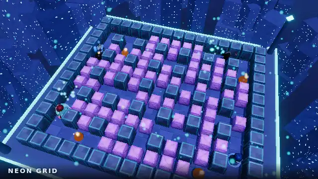
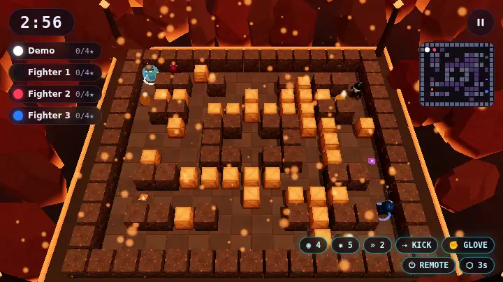

<div align="center">


# Detonarium

**A full-3D Bomberman-inspired arena battler that runs in a browser tab, installs as an app, and works on a plane.**

[Play now](https://detonarium.com) · [How it works](#architecture) · [Stack decisions](#choosing-the-stack) · [Run it yourself](#running-it-yourself)

</div>

---

Blast the soft blocks, grab what falls out, and out-think three bots or seven
strangers. Everything is rendered in real 3D, the soundtrack was generated with
Suno 5.5, the effects with ElevenLabs, and the bomber cast with Meshy and Rodin. The whole
thing — client, authoritative multiplayer server, database, auth and media —
deploys as **one Cloudflare Worker**.

```
┌──────────────┬────────────────────────────────────────────────────────────────┐
│ Play         │ Solo vs bots · Local 2P · 8-player online                       │
│              │ Expedition runs · Survival waves · Campaign · Training          │
│ Win by       │ First to N kills · Most kills on the clock · Elimination        │
│ Online       │ Quick match · private rooms by code or link · Elo ladder        │
│ Learn        │ A seven-drill tutorial that teaches the whole game              │
│ Bombers      │ 8 characters, each a different silhouette, not just a colour    │
│ Arenas       │ 6 hand-authored layouts, 9 looks, 4 and 8 player                │
│ Power-ups    │ 12, plus 7 curses that make you regret the skull                │
│ Bots         │ 4 tiers, danger-map pathfinding, trap detection                 │
│ Install      │ PWA · offline matches · auto-updating                           │
│ Controls     │ Keyboard · gamepad · two-player keyboard · touch                │
└──────────────┴────────────────────────────────────────────────────────────────┘
```

## Gallery

<table>
<tr>
<td width="50%"></td>
<td width="50%"></td>
</tr>
<tr>
<td><b>Neon Grid</b> — the classic lattice, in synthwave chrome. Every block, blast, surface and backdrop is generated at load. Character models load from R2 and are cached for offline play; their references, rigs and preparation steps are documented below.</td>
<td><b>Magma Core</b> — open lanes and long sightlines. Each arena carries its own palette, fog, key light and soundtrack.</td>
</tr>
<tr>
<td></td>
<td></td>
</tr>
<tr>
<td><b>Glacier Vault</b> — tight corridors and dead ends. Kick a bomb down a corridor and it keeps going until it hits something.</td>
<td><b>The Void</b> — a floating slab above nothing at all, and one of two arenas that seats eight.</td>
</tr>
<tr>
<td></td>
<td></td>
</tr>
<tr>
<td><b>Chain reactions</b> — a blast that touches a bomb sets it off two ticks later, so a well-placed bomb can cascade across half the board.</td>
<td><b>Sudden death</b> — when the clock hits zero, indestructible blocks fall in an inward spiral and crush whatever is underneath.</td>
</tr>
<tr>
<td></td>
<td></td>
</tr>
<tr>
<td><b>The HUD</b> — live power-up readout, per-player lives, kill feed, and a minimap that shows bombs and blast footprints.</td>
<td><b>On a phone</b> — a floating thumbstick that re-centres wherever your thumb lands, and a camera that automatically zooms in when the arena would otherwise render too small.</td>
</tr>
<tr>
<td></td>
<td></td>
</tr>
<tr>
<td><b>Eight bombers</b> — seven new Meshy models alongside the original Ninjabot, each with its own silhouette and skeletal walking/running clips. The preview and tile thumbnails use the same models as the arena.</td>
<td><b>Training</b> — seven drills that each isolate one idea and watch the simulation for proof you did it. Glowing floor markers say "stand here" without words.</td>
</tr>
<tr>
<td colspan="2"></td>
</tr>
<tr>
<td colspan="2"><b>The front end</b> — the menu sits over a real bot match, not a backdrop. It is the same code path the game uses to play, which is also how the footage on this page was recorded.</td>
</tr>
</table>

---

## Choosing the stack

Six decisions, each with real alternatives. The tables are the comparison; the
paragraph after each is why the winner won *for this particular game*.

### Frontend hosting

| | Pros | Cons |
|---|---|---|
| **Cloudflare Workers + static assets** ✅ | Same origin as the game server, so auth cookies and WebSockets need no CORS dance; one `wrangler deploy` ships everything; assets served from 300+ PoPs; free tier is generous | Asset router is less featureful than Vercel's; no built-in image optimisation |
| Vercel | Best-in-class DX and preview deployments; excellent edge network | The realtime server would have to live elsewhere — a second origin, cross-site cookies, and a second deploy pipeline. Vercel functions cannot hold a 30 Hz WebSocket game loop |
| Netlify | Simple, reliable static hosting; good forms/redirects | Same split-origin problem; Netlify Functions are request/response, not stateful sockets |
| Railway | Can host client *and* server in one container | You pay for idle, it lives in one region, and you lose the edge CDN entirely — a player in Sydney downloads the bundle from Virginia |

**Why Cloudflare.** The deciding factor is not static-asset performance — all four
are fine at that. It is that the authoritative multiplayer server has to be a
Durable Object (below), and putting the client on the *same* Worker collapses
three problems into zero: no CORS preflight on `/api`, no `SameSite=None`
third-party cookie for the session, and no second deploy to keep in sync. The
WebSocket upgrade terminates at the same PoP that served the HTML.

### Realtime backend

| | Pros | Cons |
|---|---|---|
| **Cloudflare Workers + Durable Objects** ✅ | Exactly the primitive a match needs: one single-threaded, globally-addressable, strongly-consistent object per room, with a WebSocket and a timer; created on demand, migrates near the first player, costs nothing idle; zero-hop access to D1 and R2 | No batteries-included matchmaking (I wrote a 30-line room prober); a 30 Hz `setInterval` keeps the object billable for the length of a match; 128 MB per object |
| Colyseus + Render | Purpose-built room/state-sync framework with schema serialisation, built-in matchmaking, a monitor UI, and a mature client SDK | Needs an always-on container: either pay for idle or accept cold starts on the free tier. Single region. Scaling past one process means running a Redis presence driver and sharding rooms yourself |
| Colyseus + Railway | Same framework, nicer DX, easy Postgres alongside | Same single-region and always-on tradeoffs; usage billing on a game server with idle lobbies is awkward |

**Why Durable Objects.** Colyseus is genuinely the better *framework* — if this
needed complex matchmaking or a room lifecycle I did not want to write, it would
win. But a Bomberman room is small and I already had to write the simulation. What
I actually needed was "a consistent single-threaded process, addressable by name,
near the players, that costs nothing when nobody is playing." That is the literal
definition of a Durable Object. The honest cost is that I hand-rolled matchmaking
and reconnection, which Colyseus gives you.

### Database

| | Pros | Cons |
|---|---|---|
| **Cloudflare D1** ✅ | Runs in the same runtime as the Worker and the Durable Object — no network hop, no connection pool, no cold TCP handshake; SQLite semantics; migrations built into wrangler; read replication available | SQLite, so no `RETURNING` on some paths, limited concurrent writers, 10 GB per database; ecosystem is younger |
| Supabase | Real Postgres with extensions, row-level security, realtime subscriptions, storage and auth in one box; superb dashboard | Every query from the edge is a round trip out of Cloudflare's network. Adds a second vendor and a second set of credentials for a schema that is four tables of integers |
| Render Postgres | Solid managed Postgres, predictable pricing | Same cross-network hop; free tier databases expire |
| Railway Postgres | Great DX, trivial to provision | Same hop; usage-based billing on an always-on database |

**Why D1.** The workload is tiny and write-light: a row per finished match, an
upsert per player. What matters is latency from the code that writes it, and the
Durable Object writing to D1 never leaves Cloudflare's network. If this grew
social features, friend graphs or realtime presence queries, Postgres would be the
right answer and Supabase would be the way to get it.

### Authentication

| | Pros | Cons |
|---|---|---|
| **Better Auth** ✅ | Runs *inside* the Worker — no external auth round trip; native D1 support; the anonymous plugin mints a real user row so a first-time player is on the leaderboard in one tap and can link GitHub/Google later without losing progress; you own the session config | You own the session config — secret rotation, cookie flags and OAuth app registration are yours |
| Supabase Auth | Hosted, audited, huge provider list, magic links and MFA for free, great admin UI | Means adopting Supabase for a project not otherwise using it; every session check is a network call from the edge; and the natural home for the user rows is then Supabase's database, not D1 — splitting the data |

**Why Better Auth.** The anonymous-to-linked upgrade path is the feature that
decided it. A game that asks you to sign up before you can play has already lost;
a guest session that quietly becomes a real account when you feel like it is the
right shape, and Better Auth does that in-process against the database the rest of
the game already uses.

### Heavy media

**Cloudflare R2**, as specified — and it is the right call. The soundtrack is
~19 MB of MP3. Putting it in the deployed bundle would bloat the service-worker
precache and make first load miserable on mobile data. Instead the Worker serves
R2 through `/media/*` with `Range` support and immutable cache headers, and the
service worker caches each track *after it is first played*. The soundtrack
arrives as you use it. No egress fees is a bonus, not the reason.

The eight bomber GLBs use `/media/bombers/` and total 5.48 MiB, with each file
between 0.41 and 0.90 MiB. With model rendering enabled, startup requests all
eight; the service worker caches them for subsequent offline play. A missing character asset uses a procedural
fallback; it does not block the match. The reference images and raw source
archives are development inputs and are not downloaded by players.

### Game engine

| | Pros | Cons |
|---|---|---|
| **Three.js** ✅ | A rendering library, not an engine — so the deterministic game simulation stays plain TypeScript I can run verbatim in the browser *and* inside the Durable Object; arena geometry is procedural; authored bomber and creature GLBs load separately from the application precache | You write your own everything: game loop, collision, scene management, object pooling |
| Phaser | Superb 2D arcade framework, tiny, huge community | It is 2D. The brief is 3D |
| PlayCanvas | Real WebGL engine with an excellent visual editor and strong mobile performance | Editor-centric workflow fits a team with artists more than a code-first repo; heavier runtime than this needs; the shared-simulation trick is harder when the engine owns the loop |
| Unity | Enormous ecosystem, great tooling, WebGL export | 5–15 MB WASM + data, multi-second first load, poor mobile-browser behaviour. Fatal for "tap a link and play" and for offline PWA install size |
| Unreal | Best-in-class rendering | HTML5 export is effectively unsupported; bundle sizes are far worse than Unity's |
| Godot | Open source, pleasant editor, improving web export | Web export still ships a multi-MB WASM runtime and has known audio/threading friction on iOS Safari |

**Why Three.js.** The single most important architectural property of this game is
that **one simulation runs in three places** — the server (authority), the client
(prediction), and offline play (the whole game). That is only comfortable if the
simulation is plain, dependency-free TypeScript that knows nothing about
rendering. An engine that owns the main loop fights that. Three.js is happy being
told what to draw and nothing else. The size argument reinforces it: the entire
playable game precaches in about 1.5 MB, which is what makes the offline claim
real — install it, go offline, and you can still play a full match against bots.

---

## Architecture


**Nothing on that diagram is typed by hand.** `tools/gen-architecture.mjs` reads
the bindings out of `wrangler.toml`, the route prefixes and all eight `/api`
endpoints out of `worker/index.ts`, the providers out of `worker/auth.ts`, the
tick rates and player cap out of `src/shared/constants.ts`, the reconnect window
out of the Durable Object, the track counts out of the audio manifest and the
tables out of `migrations/`, then emits SVG. Add a route and a card appears; drop
a binding and its box goes. It renders byte-identically every run, so it diffs,
and the labels stay real text — `/api/auth/*` is searchable in the file and
readable by a screen reader.

Derived strings are longer than hand-chosen ones, so the text is *measured*
rather than estimated: the generator opens a canvas, measures each string in its
real font, and fits it to the card. Guessing at characters-per-line is what put
`rooms/list` through a border on the first attempt.

Getting there ruled out the obvious shortcut. The first attempt asked image
models for a diagram — four of them, in a bake-off — and they were confidently
wrong in the way generated pictures always are: KV namespaces, a Hono server,
Stripe, Sentry and a desktop wrapper, none of which exist here. One also rendered
`/api/*` as `/api(*` and `Durable Object` as `Durable Obtiect`. A drawing whose
entire job is exact route names cannot come from a process that is right most of
the time, which is why this one is produced by code instead.

### Where the assets come from


The props in that arena are not modelled by hand and not taken on trust.
`tools/gen-pipeline.mjs` draws this one the same way — the candidate counts, the
credit total, the decimation defaults and the list of what actually ships are
all read out of the manifests and `src/shared/maps.ts` at generation time, so
the diagram cannot claim a bake-off that did not happen.

Two things it records are there because getting them wrong was expensive.
**Provenance**: each candidate stores the sha256 of the reference image it was
built from, because two models that name the same path can still have seen
different pictures — one rack column was judged for a session before anyone
noticed half of it predated a reference change. **`asked` versus `got`**: the
prep step stores the triangle target it requested *and* the count it reached,
which disagree for four of six candidates, because a simplifier cannot collapse
across a UV seam or a part boundary and a mesh in 54 pieces stops at 4,208
triangles however low you set the target.

The last stage is the one that keeps the rest honest: the sweep runs on a real
phone. Software rendering in a codespace has been wrong about this project four
separate times.

### Generating new assets

For playable characters, use [the bomber pipeline](#generating-bomber-assets),
which preserves skinning and animation. The creature pipeline below prepares
static geometry and must not be used on a rigged bomber.

The working path for a new creature is **brief → imagegen reference → image-to-3D
GLB → preparation → in-game review → R2 upload → deployment**. The diagram above
records the earlier scenery bakeoff; generating a new asset does not require
submitting it to every service. Expedition's four creatures were made with
Codex's built-in **imagegen**, then one **Meshy 7** image-to-3D job per species.

The outcome to judge is a creature a player can recognise at arena zoom, moving
among walls and explosions. A detailed close-up alone does not establish that.
These references keep the bomber's matte moulded shell, broad seams and charcoal
face recesses, with a different outline and established colour for each role:

| Drifter | Stalker | Phaser | Brooder |
|---|---|---|---|
|  |  |  |  |
| Round shell, small feet; bounces along lanes | Low wedge, mandibles, four feet; faces its pursuit | Floating hood and fins; translucent in the game | Broad purple shell with Drifter-shaped nodules; splits on defeat |
| 6,000 triangles · 391 KiB | 5,999 triangles · 541 KiB | 6,000 triangles · 375 KiB | 6,000 triangles · 450 KiB |

Those are the measured prepared files, each with three maps capped at 512px.
[The runtime manifest](assets/enemies/manifest.json) records exact bytes, hashes,
selected files and scale. [The reference manifest](assets/enemies/references/manifest.json)
and the adjacent `*.prompt.txt` files record the imagegen inputs. Raw GLBs stay
out of git; their generation records are in
[assets/models/enemies](assets/models/enemies).


That is the prepared model set in the engine with a closer review camera.
The [full-arena capture](docs/enemies/webgpu-lineup.webp),
[Phaser over a floor decal](docs/enemies/webgpu-phaser.webp) and
[verification results](docs/enemies/verification.json) record the in-game checks.

1. **Write and generate the reference.** Use the imagegen skill in Codex with
   [the bomber reference](docs/character-reference.webp) as the material/style
   guide and a species brief such as
   [drifter.prompt.txt](assets/enemies/references/drifter.prompt.txt). Request one
   complete creature in one slightly elevated three-quarter view, centred on a
   plain background, evenly lit, with no pedestal, text, scenery or cast shadow.
   Use large connected forms; thin antennae and barely separated feet are easy
   to lose during reconstruction. For the Phaser, generate an opaque reference
   and add translucency in the renderer. A transparent input hides the shape
   the reconstruction needs.

   Use Codex's built-in imagegen tool; it needs no `OPENAI_API_KEY` in this
   repository. Save the selected PNG and exact prompt under
   `assets/enemies/references/`, and record the generator, style inputs and SHA-256
   in its manifest. Inspect the image before spending 3D credits. Keep a new
   candidate under a new name: generation is not deterministic, and a path alone
   does not identify which image produced a model.

2. **Preview one image-to-3D request, then submit it.** Run `npm ci` first and
   supply `MESHY_API_KEY` through your shell or Codespaces secrets. The focused
   command accepts any local PNG/JPEG, so it can also generate a new prop:

   ```bash
   node tools/image-to-model.mjs --input assets/enemies/references/drifter.png --out assets/models/enemies/drifter-v2
   node tools/image-to-model.mjs --input assets/enemies/references/drifter.png --out assets/models/enemies/drifter-v2 --submit
   ```

   The first command makes no network request and spends nothing. The second
   sends the exact local image as a data URI, pins `meshy-7`, disables reference
   enhancement, requests PBR textures, approximately 6,000 triangles, and leaves
   A/T posing off for these non-humanoid creatures. Meshy's supported inputs and
   settings are documented in its [image-to-3D API](https://docs.meshy.ai/en/api/image-to-3d).
   These four jobs each reported 30 credits, 120 total; check
   [current API pricing](https://docs.meshy.ai/en/api/pricing) before a later run.
   The account's API credit pool is separate from its website subscription.

   The command saves a `*.meshy.json` task record before polling, then downloads
   `*.source.glb`. An interrupted poll or download is resumed without buying
   another model:

   ```bash
   node tools/image-to-model.mjs --input assets/enemies/references/drifter.png --out assets/models/enemies/drifter-v2 --resume
   ```

   A changed reference is rejected. If a submission loses its response before a
   task ID is received, the record stays `SUBMITTING`: inspect Meshy's task
   history and recover the ID before retrying. Do not delete that record just
   to bypass the guard. Provider download URLs expire; archive the selected
   source as well as its task ID.

3. **Prepare and select the GLB.** For an existing Expedition species:

   ```bash
   node tools/prepare-enemy.mjs drifter assets/models/enemies/drifter-v2.source.glb
   ```

   This uses `prep-prop.mjs` to reduce geometry and textures, rejects files over
   the creature budget, writes a content-hashed GLB under
   `assets/models/enemies/runtime/`, archives the source under `source-archive/`,
   and updates the selected species in `assets/enemies/manifest.json`. It keeps
   the existing width and facing adjustment. Set `yaw` there if the reconstructed
   front does not point along **+Z**; `width` is the maximum horizontal span in
   arena tiles. The loader centres X/Z and places the lowest point at ground
   level. The Stalker's recorded `stretch` widens and raises a reconstruction
   that came back too narrow, before fitting it to that span. The Brooder is
   visually wider than a tile; its collision is unchanged.

   This preparation path accepts static meshes. It does not preserve skeletons
   or animation clips. These creatures use whole-body bounce, lean, hover and
   breathing; walking distance drives the gait, and faces do not spin away from
   their travel direction. A creature that needs articulated limbs needs a
   separate rigging pass and animation integration. The bomber's specialised
   `prep-bomber-model.mjs` part heuristics do not apply to a beetle.

   For a prop, use the same generator with a prop reference and prepare its
   chosen GLB directly with `tools/prep-prop.mjs --tris <budget> --tex <edge>`.
   The older `gen-model.mjs`, `rodin-web.mjs`, `tripo-web.mjs` and `hi3d-web.mjs`
   remain available for their existing bakeoff assets. They have different
   credentials, presets and spend controls; they are not interchangeable
   wrappers for this command. For another provider, use `prep-prop.mjs` directly
   and record its reference, provider settings and source hash before updating
   the selected-asset manifest; `prepare-enemy.mjs` expects the matching Meshy
   job record from the focused command. Preserve a PBR export rather than a render with studio light baked
   into its base colour.

4. **Review the actual game.** Local enemy files are served at `/enemy-models/`;
   the shipped game uses `/media/enemies/`. The loader shares geometry/textures,
   clones materials for independent hit feedback, and retains a visible fallback
   if a fetch fails. Check a normal Expedition start, all four species together,
   room changes that reuse IDs, movement, damage flash and the enlarged HUNT
   target. Inspect both arena and phone-sized captures, including a light and a
   dark arena. Check the Phaser against walls with translucency enabled.

   ```bash
   npm run typecheck
   node tools/image-to-model-test.mjs
   node tools/enemy-assets-test.mjs
   # Linux software-rendered drawing verification; install these once if absent:
   sudo apt-get install -y xvfb xauth libvulkan1 mesa-vulkan-drivers
   npx playwright install --with-deps chromium
   DTN_MEDIA_ORIGIN=https://detonarium.com xvfb-run -a node tools/enemy-model-test.mjs
   ```

   The browser check uses **headed Chromium with Vulkan SwiftShader** for real
   WebGPU presentation and **SwANGLE** for WebGL, following Chromium's
   [software-rendering configurations](https://chromium.googlesource.com/chromium/src/+/main/docs/gpu/swiftshader.md).
   It writes PNGs plus results to
   `node_modules/.cache/dtn/enemies/`. It also checks that floor decals cannot
   paint over the translucent Phaser's face. Inspect those pictures; passing assertions
   does not decide art quality. Software rendering verifies drawing here, while
   frame-rate, thermals and real-driver compatibility still need a physical
   phone. No new physical-device performance measurement is claimed for these
   assets.

5. **Upload selected assets, then ship the references to them.** With
   `CLOUDFLARE_API_TOKEN` configured for the existing R2 bucket:

   ```bash
   node tools/upload-media.mjs assets/models/enemies/runtime audio/enemies
   node tools/upload-media.mjs assets/models/enemies/source-archive audio/enemies/sources
   ```

   Keep these directories limited to selected versions, or use the uploader's
   third argument to filter one filename. Check each selected
   `https://detonarium.com/media/enemies/<file>` returns the expected GLB and hash
   before deploying (`node tools/enemy-assets-test.mjs --media-origin https://detonarium.com`).
   Filenames contain their content hashes because media is
   cached as immutable; replacing bytes at an existing URL would strand cached
   clients on old art. Commit the source images, prompts, manifests, renderer
   and documentation, then push `main` to run the deployment workflow. Verify a
   fresh Expedition on the deployed build. To restore a source later, fetch
   `/media/enemies/sources/<sourceArchive>` from the runtime manifest; a fresh
   checkout can fetch `/media/enemies/<file>` into the local `runtime/` directory.
   To download and verify all selected runtime files in one step, run
   `node tools/enemy-assets-test.mjs --media-origin https://detonarium.com --download`.
   CI uses this same check before its headed WebGL creature regression run.

### One simulation, three consumers

`src/shared/` is the whole game: tile grid, movement, bombs, blasts, chains,
power-ups, curses, sudden death, win conditions and the bot brain — about 2,600
lines of dependency-free TypeScript. It is imported unchanged by:

- **the Durable Object**, which is the authority for online matches;
- **the client**, for movement prediction and for fully offline play;
- **the bots**, which produce the same four-field `Input` a human controller does —
  so a bot, a thumbstick, a keyboard and a gamepad are interchangeable.

### Rating

Online results move an Elo rating, which starts at 1000 and is what the ladder
is ordered by. Elo is defined for a duel, so a free-for-all is scored as the
round robin it actually is: every player is compared with every other, 1 for
finishing above them, 0 below, 0.5 for a tie, with the per-pair K divided by the
number of opponents. An eight-player win therefore moves a rating about as far
as a duel does rather than seven times as far, and the table stays zero-sum.

Only matches with two or more *signed-in humans* are rated. A win over three
bots is not a ranked result, and a solo score is self-reported by the client —
fine for a lifetime total nobody competes over, not for a number that decides a
ladder. `sim-test` covers the arithmetic, because it is the one part of the
online path where being quietly wrong would be invisible:

```
even duel ±12 · upset over a 1600 +23 · four-player win +12 · table sums to 0
```

The profile screen is built from the same counters: matches, wins, win rate,
KOs, K/D, time played, ranked record, and which power-ups a player actually
picks up. Achievements are *derived* from those numbers rather than stored, so
there is no award table to backfill when the list changes and no way for the two
to disagree — the cost being that every achievement has to be expressible as a
threshold on a counter.

### Win conditions

Three, and the one you get by default is **most kills on the clock**:

| | What ends it | What happens when you die |
|---|---|---|
| **Most kills** | The clock, three minutes | You respawn after a beat |
| **First to N kills** | Somebody reaches the target — four, by default | You respawn after a beat |
| **Elimination** | One bomber left standing | You spend a life; out of lives is out of the round |

Elimination is the arcade original and it is still there, but it is not the
default, because it is a bad first thirty seconds: the player who dies first
watches the other three finish. Deathmatch costs a death nothing but the
respawn timer.

The default moved from a kill target to the clock when [hit
points](#the-rules-and-how-to-switch-them-off) arrived, and the two are a
package rather than two settings. A target of four was tuned for a game where
one blast is one elimination — against bots it decided roughly two matches in
three and averaged about two minutes:

```
target   decided by the target   average round
  3            9 / 12                100s
  4            7 / 12                121s
  5            6 / 12                134s
  6            5 / 12                152s
```

Three hit points produce about **one kill in a whole match**, so that target is
reached 6 times in 40 and the other 34 run out the clock — which reads as the
game stopping rather than ending. `killTarget` is still there and `?win=kills`
still selects it; it is simply not what a health game wants.

Sudden death is what happens when the whistle finds a **draw**. In elimination
it always runs; in a deathmatch it runs only if the scoreboard is still level
at the top, because a match with a leader has nothing to break. Otherwise a
health game hands 13 matches in 60 to a tiebreak on score, having produced
about one kill between four players — a winner nobody in the arena chose.

It was elimination-only before, on the grounds that closing walls in on players
who keep respawning grinds them into the rubble. That is true and the fix is
not to exclude the mode: **nobody respawns in sudden death**. Being caught by
the walls takes every life you have left, whatever the win condition and
however many were showing — the mechanic is named for that, and a wall you can
come back from is not it.

### The rules, and how to switch them off

Three rules that used to be behind URL flags and now ship on, for everyone,
locally and online. The flags remain, and they take `0` as well as `1`, because
a rule that is on by default needs a way back:

```
?hp=1         one blast, one elimination: the pre-health game
?resolve=0    no comeback scaling on damage
?losegear=0   keep your specials through a death
?win=kills    first to N kills, instead of the clock
?lives=3      how many times you come back
```

The whole game as it was before any of this is one link:
`?hp=1&resolve=0&losegear=0&win=kills` — or `?rules=deathmatch`, which is the
same thing with a name.

| ruleset | what it is |
|---|---|
| **Standard** | the shipped game: three hits, comeback scaling, specials lost on death, clock |
| **Classic** | one blast one elimination, three lives, last bomber standing, flat table |
| **Deathmatch** | first to four kills, one hit, nothing lost and nothing handed out |
| **Competitive** | flat table, no comeback scaling, one life, three hits — nothing decides a match for you |

Every switch a ruleset sets stays individually reachable; this is a shortcut,
not a gate. The row reads the current settings back rather than remembering
what was picked, so flipping one switch afterwards says **Custom** instead of
going on claiming Competitive. `?rules=classic&hp=3` works and means what it
looks like — the preset lands first and the flags amend it.

`Standard` has to equal the shipped defaults exactly, and `npm run sim-test`
checks it: a preset called Standard that plays something else is worse than no
preset at all.

#### The mid-air punch

A bomb already flying can be punched again — including one flying at you. It
needs the Power Glove, the bomb keeps ticking while it is in the air, and a
bomb whose fuse has run out cannot be volleyed any more. The timing window is
however long the bomb takes to cross the tile in front of you, about a sixth of
a second.

It is the only mechanic here aimed at the top of the skill range rather than
the bottom. Everything else narrows the gap between players; this gives a good
one something to be good at, and turns "a bomb is coming at me" from a running
problem into a reading problem.

It costs no new state and nothing on the wire — a deflection is just another
flight, which the snapshot already carries a flag for. Two things it did need:

- **A separate lookup.** `bombAt` skips bombs in flight, because every other
  caller is asking whether a tile is blocked and a bomb overhead blocks
  nothing. The first version of this read the same function and could never
  have fired.
- **The fuse now runs in the air.** It used to stop, which handed a punched
  bomb an extra 0.45 seconds of life, and which would have made a rally
  endless. A bomb is on the clock the whole time it is being volleyed.

**It was unmeasurable until the bots were fixed, and the reason was not the one
it looked like.** Against bots the mechanic fired once in eighty matches, which
read as an item problem: the Power Glove is 2.5% of the drop table. Raising it
to 25% and re-running produced one punch. The item was never the constraint.

The constraint was that the bots' punch branch could not be reached. A bomb in
the tile in front of you covers the tile you are standing in, so `inPeril` is
true and `botInput` returns from the survive branch three steps before the
punch check. Over 24 matches the bots held the glove for **84% of player-ticks**
and had an enemy bomb directly in front for **5,656** of them, and punched
once. Punching a bomb out of your face *is* an escape, so it now happens inside
the survive branch, merged with the flee rather than replacing it — it costs no
movement. Punches went 0 → 56 across 32 matches and deflections 0 → 24.

At the shipped drop rate it is sparse but real: 10 punches and 5 deflections in
32 matches.

Making the glove common to get more of it would cost something. `PUNCH` has
been weight 5 since the first commit with no reason written down anywhere, so
the base weights were measured rather than assumed — 400 eight-player matches
per table:

| advantage at 30s | shipped | more items | flat weights |
|---|---|---|---|
| damage dealt | 44% | 50% | **55%** (p = 0.004) |
| bomb count | 27% | 27% | **18%** (p = 0.034) |
| gear flags | 49% | 48% | 54% |

Flattening the weights — every item as likely as every other, so the gear that
decides matches is as common as an extra bomb — makes the early lead convert
significantly better. That is the **first** thing about the drop table that has
moved this number: the weighted bias did nothing, re-aiming it did nothing, and
turning the whole catch-up system off did nothing, but the base rarity of gear
is load-bearing. The weights nobody chose are doing real work.

#### Supply drops

Twice a round — at 55% and 25% of the clock remaining — six crates are
scattered across the arena, announced three seconds ahead. `?events=1`, or the
switch in the panel. Off by default while it is being judged.

**Crates, not pickups, and scattered rather than piled.** The first version put
five items on the floor in a cluster in the middle, on the theory that a
contested pile is more interesting than a sprinkle. Played, it is worse:
whoever stands nearest sweeps the lot. Farthest-point sampling puts six crates
in six parts of the arena, and the item sits *inside* a soft block, so a drop
has to be opened with a bomb rather than collected on the run — which costs
time, and gives everyone else those seconds to arrive.

Nothing lands on a player or in the square beside one, and no crate is kept if
it would wall anybody in: each is placed, the board is walked from every living
player, and a crate that leaves any of them unable to reach the others is
dropped. Soft blocks count as walls for that check, because "you can bomb your
way out eventually" is not the same promise as "the arena is still one place".

Everything about it is derived rather than stored: the landing ticks are a
function of `roundSeconds` and the cells a function of the match seed, so
nothing new goes onto the wire and every client reaches the same conclusion at
the same tick without being told. It draws from the ordinary table with `NONE`
and `SKULL` removed — nothing is worth running into the open for if it might be
nothing, and a curse in a contested pile is a trap rather than an event.

It exists because the balance work had only ever narrowed the gap. Nothing in
it gave anybody a reason to take a risk, which is the half of Mario Kart's
answer that is not about helping the player behind.

Measured against what it was supposed to do — more variance, without the first
death coming sooner:

| 200 matches, four players | no events | pile (first try) | crates |
|---|---|---|---|
| lead changes per match | 3.48 | 4.03 | **3.83** |
| winner first led at | 20.8s | 26.5s | **28.8s** |
| comeback rate | 48.5% | 44.5% | **55%** |
| first blood | 114.5s | 110.0s | 109.3s |
| material spread at 90s | 6.05 | **7.05** | **6.18** |

The lead changes more often and the eventual winner takes it eight seconds
later, with first blood unmoved. The pile's real cost was the last row — it
widened the gap between equals by a whole power point, which is what putting
free items on the floor does. Crates cost almost nothing there, because a crate
is earned rather than swept.

At six hundred eight-player matches the pile version moved no predictor at all,
every one within noise. `npm run mechanics-test` watches the rest: that crates
scatter, that nobody sweeps a drop, and that nobody ever ends up standing
inside a block.

They are in the match settings panel too, so a room can be switched to any of
them by its host and a couch match by whoever is holding the pad — a URL is a
poor way to ask four people in a lobby to agree on a rule. The room clamps
whatever a host proposes, because a field the wire can set and the validator
does not name reaches the simulation exactly as it arrived.

Changing one of them redraws the panel, which it did not do before: the win
condition decides whether Lives or Kill target is offered below it, hit points
decide whether comeback is offered at all, and several rows read their own
value back in their description. Chips only ever repainted themselves, so the
panel kept describing the setting you had just left — something `winBy` had
quietly done since the row was added. The redraw keeps your scroll position,
because these rows are a long way down.

They are stored preferences, so they survived a change of default the way any
stored preference would — badly. `winBy: 'kills'` saved by a returning player
under a new default of three hit points is the one combination measured to
break, so `Prefs` carries a `rulesVersion` and a bump re-seeds the rule fields
and nothing else. Names, bombers, records and arenas are the player's;
`npm run prefs-test` holds that line.

They ship because of a measurement. `npm run balance-attribution` asks which
advantage at thirty seconds actually predicts the winner — chance is 12.5% in
an eight-player field — and the answer was never the one the game was designed
around. Spatial board control is noise. **What compounded was the early hit.**

Six hundred matches per arm, eight players, last-one-standing, on the round
length the game actually ships — **three minutes**:

| advantage at 30s | 1 HP (shipped) | 3 HP | 3 HP + resolve + losegear |
|---|---|---|---|
| damage dealt | 45% | **26%** | **19%** |
| hits landed | 45% | **28%** | **21%** |
| gear flags | 36% | **26%** | 24% |
| speed | 26% | 25% | 21% |
| bomb count | 22% | 18% | 18% |
| range (power) | 16% | 18% | 15% |
| reachable floor | 15% | 17% | 18% |

Chance is 12.5%. So the advantage that decides the shipped game — landing the
early damage — goes from **3.6x chance to 1.5x**, which is nearly noise. Hit
points do most of it (p < 0.0001) and resolve with the series rule do the rest
(p = 0.009). Gear falls with them rather than rising, 2.9x to 1.9x.

**That table replaced one that said the opposite, and the difference was the
round length.** Both probes had `roundSeconds` hardcoded at 120 while the game
ships 180, so every balance number this project has produced was measured on a
two-minute round. On that round resolve and the series rule measure inert and
hit points appear to *raise* the value of gear; on a three-minute one they are
significant and gear falls. The rules were never the variable anybody thought
they were testing. `--seconds` is a flag on both probes now, and every run
prints the round it used along with the commit.

Five minutes is worse, not better. The obvious hypothesis — three minutes is
only long enough for one or two kills, so a lead has too little time to be
overturned — predicts that a longer match should dilute the advantage. It does
the reverse: at 300 seconds the early damage lead converts 26% of the time
against 19% at 180 (p = 0.008), because the extra time is time the leader also
gets to use. The shipped game is flat across all three lengths, 39/45/44%,
so the length only matters once there are comeback mechanics for it to act on.

| round | shipped | trial ruleset |
|---|---|---|
| 120s | 39% | 21% |
| **180s** | 45% | **19%** |
| 300s | 44% | 26% |

Which raises the question of whether that table earns its place at all.
Running the same six hundred matches with the whole catch-up system off
(`npm run balance-attribution -- --flat`, which drops both the weighted table
and the Overload) changes **nothing** — every advantage lands within noise of
where it was. This one was re-measured on the three-minute round afterwards and
survived, unlike most of what surrounded it:

| advantage at 30s | catch-up | flat | p |
|---|---|---|---|
| damage dealt | 19% | 21% | 0.43 |
| hits landed | 21% | 23% | 0.49 |
| gear flags | 24% | 24% | 1.00 |
| speed | 21% | 22% | 0.76 |

It is not useless — it was separately measured to take twelve to fifteen per
cent off the material gap between equals — but it does not change who wins,
and it never has.

Re-aiming it at the items hit points promoted was tried, twice, and does not
work either. A second bias table that bent `BOMB`, `FIRE` and `FULLFIRE` hard
under `hitPoints > 1` measured inert on a two-minute round — and then inert
again on the three-minute one, once the round length turned out to be the
thing that had been wrong all along. Every advantage lands within noise of the
table it replaces, p between 0.31 and 0.78. It is not in the code.

That second run was worth doing rather than assuming. The premise behind the
re-aimed table — that hit points promote range and bomb count — is one of the
conclusions the round-length correction killed, so the table was aimed at a
problem that only exists at 120 seconds. It would have been reasonable to
expect it to work at 180 for a different reason, and it does not: the drop
table is not the lever, at any round length, pointed at anything.

Pacing changes too, because a rule that counts eliminations cannot survive
making them rare. Twenty-four four-player bot matches:

| ruleset | mean length | mean kills |
|---|---|---|
| `?quick=1` (shipped) | 131s | 2.9 |
| `hp=3 win=timed` | 183s | 1.8 |
| `hp=3 win=lives lives=1` | 189s | 1.5 |
| `hp=3 win=lives lives=3` | 225s | 2.2 |

Left on the shipped `winBy: 'kills'` with a target of four, a three-hit match
produces about one kill and simply runs out the clock, which reads as the game
stopping rather than ending. A health game wants the clock or the last bomber
standing.

Online rooms carry the same three settings, defaulted off and clamped like
everything else the host can set. They were added to `MatchSettings` after the
room's validator was written and inherited its gap: a field that validator does
not name reaches the simulation exactly as it arrived over the wire, so a host
sending a non-numeric `hitPoints` put `NaN` health on everyone in the room —
and nobody in a match where damage is `NaN` can ever die.

A link that asks for hit points and does not name a win condition gets the
clock. Not `lives`, because elimination is what the default moved away from —
the player who dies first watches the rest finish — and because the clock
ending a match is better than the walls doing it.
`?win=` still overrides, so every pairing stays reachable, including the broken
one. `npm run sim-test` holds both halves: a plain link sets nothing at all,
and hit points never arrive without a rule that can end the match.

**The closing walls stay lethal, and trying to change that found a real bug.**
Hit points switch off for sudden death, which decides most last-one-standing
matches, so spending one point per wall instead of all of them looks like the
consistent thing to do. It is not. The tile a player is standing in has just
become solid; the spiral skips tiles that are already solid, so they can never
be crushed again; and `canStandAt` samples a box around the target that always
overlaps the wall they are inside, so they can never walk out. Across 60
matches it left **162 players entombed**, 24 of them with all four neighbours
solid, every one still in there when the match ended, one for 39.6 seconds.
Matches did still *end* — which is why the first round of checks missed it.

Measuring the same thing on the **shipped** rules is what made it worth the
trip: 57 players in 60 matches, alive inside walls, in the game as it stands.
`respawn` took the first spawn tile that was empty and fell back to the
player's home whatever was standing on it, and in a closed-down arena that is
a wall. It now takes the nearest open tile anywhere on the board, and if the
arena has closed completely the player simply does not come back — which is
what sudden death is for.

Sudden death does its job again as a result. Matches used to end with 1.5
players standing on 90% health; they now end with 0.7 on 70%, in the same
133 seconds.

```
                            before   after
  alive inside a wall         57       0
  standing at the end        1.5     0.7
  quiet tail after last death  3s      0s
```

### What the telemetry can see

`match_sample` holds five-second samples of every player's material power, and
until now the Durable Object was the only thing writing them — so every balance
question about how the game plays for **a person** was answered by bots. Solo,
Local Versus and campaign matches simulate on the device and posted a
four-number summary of how they ended, which cannot say whether the winner was
ahead from the twelfth second.

Local matches post the trace now, behind the same sign-in gate as the result
and tagged `source = 'local'`, so the two populations can be compared rather
than blended. One sampler in `shared/sample.ts` serves the room and the client:
two would be two definitions of what a sample is, and the online and offline
halves of one question would stop being comparable the first time either
drifted.

The rows carry the ruleset now — `hit_points`, `resolve`, `lose_gear` beside
the existing `catchup` — because all four ship on and all four can be switched
off. Grouping on one of them, as `/api/balance` did, averages a health match
together with a one-hit one and reports the mean of two different games. The
existing rows default to the pre-health game, which is what they were actually
played under.

The validator between a browser and that table is the load-bearing part. Rows
arrive from a client, so a row that does not parse is **dropped rather than
clamped into something plausible**: a fabricated sample is worse than a missing
one when the table exists to say what really happened. `npm run sim-test`
covers the sampler's cadence and every way a posted row can be wrong.

### Netcode

The server ticks at 30 Hz and broadcasts at 30 Hz. Because both sides build the
arena from the same seed, a snapshot only has to carry moving entities plus tile
diffs. Measured against the live deployment with four bombers in the arena, that
is **300 bytes per snapshot, about 9 KB/s down** — `npm run net-test` prints the
figure.

The broadcast rate is not a free dial. The room sends a snapshot every
`round(TICK_HZ / SNAPSHOT_HZ)` ticks, so the only reachable rates are
`TICK_HZ / N`: 30, 15, 10, 7.5. Asking for 20 silently gives 15, which is why
the divisor is now exported next to the rate rather than computed out of sight
in the worker. Going from 15 to 30 costs almost no CPU — encoding measured
**0.5 ms per second** of wall clock for eight clients, against a simulation that
is the real expense — but it does double the downstream bytes, which on a phone
is the number that matters.

It also stopped being eight times more work than it needed to be. Every client
gets a byte-identical frame except for `ack`, their own last acknowledged input
sequence, and the room used to encode and `JSON.stringify` the whole snapshot
once per client for that one integer's difference. It now encodes once and
splices the number in, which measured **six times cheaper** on a full board — so
30 Hz today costs less than 15 Hz did. `sim-test` compares hundreds of spliced
frames against the per-client encoding byte for byte, because that is exactly
the sort of trick that works until the one edge case nobody checks. Remote players are interpolated between
the last two snapshots; your own bomber is predicted forward with the same
movement code the server runs and eased back toward authority whenever a snapshot
disagrees. Large disagreements (a respawn, a punched bomb, packet loss) snap
outright. The client never wins an argument.

**Three ways in.** Quick match probes the public rooms and drops you into the
busiest one with space. A private room is a six-character code from an
unambiguous alphabet — no O/0 or I/1, because these get read aloud — which
doubles as a shareable link; the quick-match probe never looks at those names,
which is all the privacy a party game needs. Joining takes either the code or a
pasted link.

**The host picks the stage, in the lobby.** For a long time the arena picker
only existed in Local Versus, so a private room played wherever the server had
rolled. The lobby now carries the same picker: the host chooses, everyone else
sees the choice greyed out with the reason, and arenas too small for the people
already standing there are disabled rather than offered and silently refused.

Three arenas have a second look, and those get a `Auto / <look> / <look>` row
next to the picker. A chosen look never becomes something the match has to
carry: the look is still *derived* from the match seed by everybody who draws
the board, and the choice only decides **which seed gets rolled**. So there is
no new field in a snapshot, a client that has never heard of looks still agrees
with the room, and `Auto` behaves exactly as it always did.

**Seats belong to people.** A room used to refuse a connection once its player
count reached the arena's capacity — and a host arriving with the default
preference of three bots filled a four-seat arena on their own. The next device to
try quick match was handed an HTTP 409, which a browser reports as an anonymous
close indistinguishable from a dropped network, so the client reconnected, was
refused again, and sat on *"Lost connection. Reconnecting…"* until the first
device quit. Three things changed:

- **Bots stand aside.** They are filler, not tenants. The host's bot count is
  stored as a target and re-applied whenever the human count changes, so a bot
  gives up its seat when somebody joins and comes back when they leave. Only
  other players can fill a room.
- **A lobby that outgrows its arena moves to a bigger one** rather than leaving
  someone with no spawn point, and the host's arena preference is refused while
  more people are standing in the lobby than it seats.
- **A refusal says so.** The room accepts the socket long enough to send a reason
  and closes in the 4xxx range; the client reports it and stops retrying instead
  of looping forever on a door that is not going to open.
- **A connection that dies without saying so is noticed.** Not every drop sends a
  close frame: a phone that sleeps, a suspended tab or a Wi-Fi handover leaves a
  socket the room still believes is open. Nothing tested that belief, so when the
  player came back, the seat they already held looked like a live one on the same
  session id — which the room read as a second tab and seated them again. One
  person could fill a room with ghosts of themselves, and did. Two things settle
  it: clients now carry a **page id** as well as a session id, so a returning page
  and a genuine second tab are finally distinguishable and get opposite answers;
  and a client that has said nothing for thirty seconds is hung up on, which is
  safe in the one direction that matters because the client's own reconnect
  brings it straight back into the same seat.

`npm run net-test` opens two real clients against a bot-filled lobby and asserts
the second one gets in. `npm run ghost-test` asserts the three outcomes that have
to hold together when a connection dies silently: a reconnect keeps its seat, a
second tab is still a second player, and a ghost that never returns is dropped. `npm run arena-test` opens two real browsers and asserts
the rest of it: that a guest's picker is read-only, that they follow the host to
a new arena and a new look, and that the match both of them end up in is the one
the host chose.

**Two things broke the rematch button**, and both needed a browser to find —
which is what `npm run play-test` is for. It drives real clicks and keystrokes
through a real match and asserts the bomber actually moves.

- The room holds a finished match on screen for eight seconds so the last
  explosion and the scoreboard land. A host pressing Rematch inside that window
  had the request thrown away, leaving everyone parked on the results screen.
  It is queued now, and a guest pressing it counts as "ready" rather than
  vanishing.
- Worse, and quieter: the client numbers its inputs from 1 for each new
  `OnlineMatch`, and the room kept the previous match's sequence number. Every
  input of the next match was therefore rejected as stale until the client
  counted back up — about half a minute of pressing a direction and watching
  your bomber stand still. The room resets it when a match starts.

### The bots

Each bot builds a **danger map** — for every tile, how many ticks until it catches
fire, with chain reactions relaxed to a fixpoint — and then runs a time-aware BFS
that will only enter a tile it can also *leave* before that tile burns. It commits
to an escape target rather than re-deciding every tick (which made them dither in
the middle of blasts), refuses to path through a tile that became dangerous after
the path was made, and before laying a bomb it simulates the resulting blast and
confirms a refuge is still reachable. It also runs that same check *for its
target*: if the victim has nowhere to run, the shot is taken regardless of the
tier's aggression.

`npm run sim-test` plays hundreds of full matches headlessly and reports the
result. The tiers come out monotone, which is the point:

```
tier         kills  suicides   avg length   reaches sudden death   win rate vs 3 Fighters
Rookie        1.8      0.7        115s              50%                     19%
Fighter       1.8      0.7         99s              42%                     24%
Veteran       1.6      1.2        110s              42%                     26%
Nightmare     1.7      0.9         91s              33%                     34%
                                                            (25% would be an even fight)
```

Two bugs that harness caught, which playtesting would have taken hours to find:
bots were following cached paths into blasts lit *after* the path was planned, and
idle bots with nothing useful to do were wandering into their own still-burning
fire. Fixing those cut the self-kill rate by roughly five times.

A third took a drill of its own. A **remote bomb has no fuse** — it sits there
until its owner presses the button — and the danger map treated every remote bomb
as about to go off. So the moment a bot picked up a Detonator it laid a bomb, found
that every route out was permanently on fire, and stood on top of it for the rest
of the round: out of ammo, and unable to move. `sim-test` now plays four matches
per tier with a Detonator in every hand and fails if the bots stop bombing:

```
                    before          after
bombs laid            4/match       37–51/match
bombs detonated       0/match       36–49/match
bots wedged 4s+      18/48 matches   1–3/48 matches
```

Two changes fixed it. A bot's danger map now reads *its own* remote bombs as an
ordinary fuse and everyone else's as imminent — you cannot be surprised by a
button you are holding — and the trigger runs on a leash: fire it the moment it
catches somebody, and otherwise fire it once patience runs out, exactly as a fuse
would have.

### Surfaces

Nothing in an arena is a flat colour. Every surface is generated at load from a
**height field**, which drives a derived normal map (so a box catches light like
material rather than like a box), a roughness map, and the albedo:

| Recipe | Where | What it draws |
|---|---|---|
| `panel` | Neon Grid, The Void | Riveted plates, a recessed inner panel, a lit trim strip |
| `rock` | Magma Core, Glacier Vault | Cracked basalt with heat glowing out of the fissures |
| `ice` | Glacier, The Void | Voronoi facets meeting at bright fracture lines |
| `cobble` | Overgrowth | Domed stones in deep grout, with moss where water would sit |
| `circuit` | Circuit Board | One seated IC per block — epoxy body, silkscreen, legs |
| `crate` | Most arenas | Boards, a diagonal brace and corner bolts |
| `tiles` | Every floor | Slabs, grout, grime and hairline cracks |

Two details that carry more weight than they should:

- **Every recipe is periodic.** The noise lattice and the Voronoi sites wrap at
  the texture edge, so a fifteen-by-thirteen board tiles without seams — and each
  block is rotated a random quarter-turn, which is why one texture on two hundred
  blocks does not read as one texture on two hundred blocks. The crate pattern is
  deliberately asymmetric so those rotations actually do something.
- **Hard and soft blocks never share a recipe.** Knowing instantly what you can
  blow up is a gameplay requirement, not a decoration one, so the indestructible
  material is always structural (panels, basalt, cobbles, circuit board) and the
  destructible one is always visibly a thing you break (crates, ice), sitting
  smaller inside its cell. Colour alone was not enough.

Each arena also carries its own atmosphere — embers rising over the magma, snow
falling in the glacier, spores drifting through the jungle — as a single
wrapping point cloud.

### Backdrops

For a long time the arenas were lit boards floating in an unlit room: the scene
background was one near-black colour, so the six themes differed only in the
colour of their own blocks. Each now sits in a place, built from four procedural
pieces (`src/render/backdrop.ts`) that add eight or nine draw calls and 2,400 to
7,100 triangles between them, depending on the theme:

| Piece | What it does |
|---|---|
| Sky dome | A three-stop gradient — zenith, horizon, ground — with a wash of the theme's accent along the skyline. The scene fog is tinted to the *horizon*, so the far edge of the board fades into the sky rather than into black. |
| Plinth | The slab the board stands on, a lip wider than the grid, and a lit kerb around the rim. The floor has a visible end. |
| Surround | An instanced ring of theme scenery: city towers with lit windows, volcanic lumps with molten seams, seracs, canopy, server racks, drifting slabs. Four silhouettes per theme, 120–190 instances between them, darker where they meet the ground. |
| Beacons | Four pylons on the corners of the plinth — the only part close enough to cross the frame when the camera follows a player. |

**Getting the scenery on screen took four attempts, and only the last one was
about the scenery.** The first put a skyline out at 60 units and rendered a
picture identical to the one it replaced: the camera looks **down** at about 55°,
so the true horizon sits a good 30° above the top of the frame and a distant
skyline is never once in shot. What a player actually sees around the board is
the ground just beyond the plinth, so the ring moved in to a band 2.5 to 28.5
units past the plinth lip, hazing toward the horizon colour on its own terms
rather than through the scene fog, which is tuned to erase anything past 40.

That still read as a void. The next two attempts assumed the ring was there and
merely dull, and both were the wrong altitude of fix — they are live, they cost
almost nothing, and neither is visible in play. One added triplanar surface
relief to the scenery tops and the ground plane, on the reasoning that every
emissive pattern is multiplied by `1 - abs(normal.y)` and so deliberately
suppressed on exactly the top faces a downward camera mostly sees. The other
replaced the single silhouette per theme with three, since the eye stops matching
shapes to each other long before it runs out of variants. That one earns its 250
triangles, but mostly because it is also the mechanism that lets a ring hold more
than one geometry at all.

The actual reason was structural rather than decorative. Scenery stands on the
ground the **plinth drops to** — three to six units below the board — and the
height rule deliberately made the pieces nearest the board the shortest, so that
nothing could loom over the play area from just outside it. Together those two
sensible rules buried the entire inner band: nothing in the first fifth of the
ring ever rose above the board plane at all, and on The Void (a six-unit drop
against a 2.8-unit maximum height) nothing ever did. The ring had been rendering
the whole time, behind the plinth wall.

Two lines fixed it, and each is a correction to a rule that sounds right:

- **Heights are measured from the board plane**, not from the ground the piece
  is standing on, so a near piece clears the rim by construction.
- **The scatter is biased inward** — `pow(rng, 1.35)` rather than the `sqrt` that
  spreads a ring evenly by area. Even coverage is correct for a band you can see
  all of, and wrong for this one: the far half sits above the top of the frame
  and is never observed, so spreading by area spent most of the ring where nobody
  looks and left bare the part they do.

Glacier now sits in an ice field and Magma Core reads as a volcanic cavern, for
600–2,600 triangles and no extra draw calls. The board is still completely
unoccluded in both camera modes, which is the constraint the original height rule
existed to protect and which the fix had to keep.

**Modelled hero props for the plinth corners were scoped and then abandoned**,
which is worth recording because a placeholder answered it for free. Standing a
magenta box at the corners and photographing it says exactly where the camera can
see:

| out from the plinth | height | visible? |
|---|---|---|
| +2.9 | 3.6 | no |
| +2.9 | 9.5 | no — off-frame laterally |
| +1.35 | 3.6 | no — the plinth wall occludes it |
| **+1.35** | **9.5** | **yes** |

So the usable envelope is about 1.4 units out, nine units tall, and only the two
*far* corners — the near two fall off the bottom of the frame in every camera
mode. That is roughly where the beacons already stand, doing the same job. Half a
day of prompting and cleanup for two half-cropped corners is not a trade worth
taking, and the placeholder cost nothing to find out.

(One process note, since it nearly went the other way: `npm run build` is
`tsc --noEmit && vite build`, so a type error leaves `dist` **stale** rather than
absent. Three of those placement tests were shot against an old bundle and proved
nothing, because the build output was piped through `tail` and its exit code
never checked.)

`node tools/look-backdrops.mjs` renders one wide frame per arena, which is the
only way to see any of this — `look-arenas.mjs` zooms in far enough that the
background is off-screen entirely. In the browser, `bg9.stats()` reports the
frame split three ways:

```
glacier     backdrop  2936 tris /  9 draws     frame  35810 /  61
magma-core  backdrop  7076 tris /  9 draws     frame  39914 /  61
the-void    backdrop  2432 tris /  8 draws     frame  35270 /  60
```

It deliberately walks the scene rather than reading three's own `info.render`,
which resets per pass — with the composer's fullscreen output pass running last,
that reports **one triangle for the whole frame**.

Read these as *triangle cost*, not as importance, because the two point opposite
ways here. The backdrop is 7–18% of the triangles; the bombers are about 31,000
of a 36,000-triangle glacier frame and 46 of its 61 draw calls. But a bomber is a
few dozen pixels tall and there are four of them, while the board and the ground
around it fill the screen. So the thing costing the most geometry occupies the
least of the picture, and most of what a player is actually looking at is nearly
free. That is an argument for spending *more* on the surroundings, not less —
and a reminder that a triangle budget is not a measure of what a frame is made
of.

### Two contexts, and a browser that only has so many

The game holds two WebGL contexts: the arena, and a small offscreen renderer
that draws the bomber on the menu and the character select. Browsers cap how
many can exist at once, and Chrome on Android can still be holding the previous
page's when the next one asks — so a plain reload could land on "WebGL is
unavailable on this device" on hardware that had been running the game a second
earlier. `dispose()` frees three's own objects but leaves the context alive
until the browser collects it, so both renderers now call `forceContextLoss()`
and are released on `pagehide`. Boot retries a failed context twice before
giving up, and a context lost mid-session reloads rather than leaving a black
canvas.

### Turning the lights on

The backdrops helped and the arenas still read as generic, which took a second
look to explain: the *stage* was too dark to see. Overgrowth's floor was
`#171f16` — darker than the shadows cast onto it — so the board read as crates
floating on nothing rather than as ground with things standing on it, and six
themes that differ mostly in hue all came out the same murky value.

Three changes, no new geometry:

| | Was | Now |
|---|---|---|
| Tone mapping exposure | 0.92 | 1.08 |
| Hemisphere fill | 0.75, bouncing the near-black ground colour | 1.15, bouncing the horizon colour |
| Floor / block / sky palettes | as authored | lifted per channel — floors roughly 2.3×, hard blocks 1.7×, skies 2× |

ACES rolls its shadows off hard, and everything here was built out of shadow.
Bouncing the horizon colour into the fill also ties each board to the sky it is
standing under, which is the thing that stops the arena and its backdrop looking
like two separate pictures.

### A light that cost a recompile

three keys a material's shader program on how many lights are in the scene, so
**adding or removing one invalidates every material at once**. The renderer used
to create a `PointLight` for each explosion and remove it when it faded, which
measured at **32 shader compiles and 16 program links per blast**, in the middle
of the frame that drew it.

On a desktop GPU that is a hitch nobody had filed. On the Pixel 10's PowerVR
driver with shadows on it killed the tab, and "runs briefly, then crashes" was
the game running until the first bomb went off.

The blast lights are now a pool, built once and never added to or removed from
the scene again. An idle one sits at intensity zero — a little per-fragment
cost, and no recompiles. Its size is fixed for the renderer's life on purpose:
the watchdog lowers quality on a struggling device, and resizing the pool then
would trigger exactly the storm it exists to prevent.

**The rule this leaves behind: never add or remove a light at runtime.** Allocate
the most you will ever need up front and fade the unused ones to zero.
`tools/relight-test.mjs` holds it — eight explosions on every tier, asserting the
point-light count never moves and no shader declaring `NUM_POINT_LIGHTS`
recompiles.

### The driver that will not draw shadows

The Tensor G5 moved Pixel from Mali to **Imagination PowerVR**, and Chrome's own
GPU report for it reads *"Imagination drivers are buggy with context switching"*.
On `PowerVR D-Series DXT-48-1536` the game crashes with shadows enabled, so
`QUIRKY_GPUS` in `render/renderer.ts` turns them off for that renderer string.
Apple's GPUs descend from PowerVR but report `Apple GPU`, so iPhones are
deliberately not matched.

**Part of it is understood and part is not.** The light recompile above was one
trigger and is fixed. What remains: with the light churn gone and no point
lights in the scene at all, the game still dies when the bomber glTF lands. It
is the base colour map specifically — but not its size (256px crashes too) and
not its WebP encoding (a canvas upload crashes too), and `/api/shaders` compiles
that exact material cleanly on the device, in both browsers, with no driver
output. Two browsers on the same handset also disagree about the hardware:
Chrome reports 1024 fragment uniform vectors and an ANGLE-prefixed renderer
string, DuckDuckGo reports 4096 and the raw one.

`?gfx=forceshadows` and `?gfx=forcemodel` put each back, so a driver update can
be retested without a deploy.

**The method note is worth more than the finding.** Twelve rounds of stripping
things out of a broken configuration produced twelve thresholds and no cause;
the light was found in one round by adding pieces of `medium` to the one
configuration that worked. When a bisect keeps eliminating things without
converging, climb from what works rather than subtracting from what does not.

### When a start does not survive

A driver that dies during boot takes the tab with it, and the next load runs the
same code and dies the same way — the game is simply gone for that person. Worse,
Chrome's GPU process stays down afterwards, so the load after that reports "WebGL
2 unavailable" and looks like a device that cannot run the game at all. That is
what the first bug report in this thread turned out to be.

So `ui/bootguard.ts` writes down what each start is attempting and crosses it out
only after the render loop has kept running for fifteen seconds — a frame count,
not a bare timer, since a timer also fires in a backgrounded tab where the driver
was never asked for anything. A start that finds the previous attempt uncrossed
drops a rung: shadows and the loaded model, then everything discretionary. The
level that survives is kept, so a device settles rather than oscillating, and the
record is keyed by build id so a deploy starts clean.

### The tier is a guess; the frames are the evidence

`detectQuality` reads a core count, a screen size and — on Chromium only — a
memory figure, and picks a starting tier. That is the best the web offers, and
it is not much: the user agent is reduced by design and rewritten outright by
"request desktop site", and Safari reports `Apple GPU` for every iOS device, so
a table keyed on the renderer string cannot tell an iPhone 12 from a 16 Pro
Max. A native game looks up an exact model identifier and consults a table
somebody benchmarked. We cannot.

So the guess is a starting point, and `ui/autoquality.ts` corrects it from
frames. It used to only descend, which meant a device placed too low stayed too
low for good — and `detectQuality` deliberately never hands a handheld `ultra`,
on the grounds that a 4096px shadow map is not a thing to give something
battery-powered on a guess. That reasoning is about the *guess*. A phone that
has held a full frame rate for twelve seconds is not guessing, and it is now
allowed to have it.

The awkward part is that a frame rate under vsync is one-sided evidence: 60 on
a 60Hz panel means "not the limit yet" and says nothing about how much room is
left, and nothing on the web reports the refresh rate. So the bar for climbing
is set relative to the best that device has ever managed — which is what its
refresh rate looks like from in here — and a climb is then **tried and
measured** rather than predicted.

| | bar | what it means |
|---|---|---|
| climb | ≥ 58fps **and** ≥ 95% of the best seen, for 3 windows | missing nothing, for twelve seconds |
| probation, the next window | ≥ 50fps **and** ≥ 75% of what was given up | the climb was worth it |
| hold, thereafter | ≥ 50fps, but only for a tier this loop asked for | thermal throttling arrives minutes later |
| drop | < 34fps | this tier is failing, whoever chose it |

Asymmetric on purpose: climbing needs proof, staying needs only to be above the
60 this game is played at. A 120Hz phone that lands on 90 at ultra keeps it; one
that falls from 80 to 55 does not. A tier that fails is written off for the rest
of the build, so nothing oscillates, and a tier held for twenty seconds is
written into preferences so the next session starts there instead of climbing
to it again — keyed by build id, because the thing that could not hold ultra may
have been the game, and a device that has been written off should find out when
it is fixed.

#### Frames are a lagging indicator, so ask the device too

By the time a phone has throttled far enough to miss frames it has been too hot
for a while, and the player has already felt it. The [Compute Pressure
API](https://developer.mozilla.org/en-US/docs/Web/API/Compute_Pressure_API) is
the leading indicator: `PressureObserver` reports `nominal`, `fair`, `serious`,
`critical`, deliberately bucketed rather than numeric so it cannot be used to
fingerprint a machine.

**Pressure tells. It decides nothing.**

| state | what happens |
|---|---|
| `nominal` | nothing |
| `fair` | nothing |
| `serious` | the player is told the device is heating up, once |
| `critical` | told again, with a warning that it may stutter |

**None of these states is a published threshold.** Neither the Compute Pressure
specification nor Apple's thermal state says what temperature or what
utilisation any of them means — each is whatever that implementation decided,
and two browsers on one phone can disagree about it exactly as they already
disagree about how much memory the phone has.

Two versions of this were more ambitious and both were wrong. The first stepped
a tier down on `serious` without waiting for frames to fall, which is what a
leading indicator is for and is still a quality decision made on a number of
unknown meaning. The second only withheld a *climb* while the device read warm,
on the argument that withholding an increase takes nothing away — but that is
half-trusting a signal you do not trust, which is the worst of both. A device
that cannot hold a tier says so in its frames, and the frames are measured here
rather than bucketed by somebody else.

So the states are a readout, and the frame-rate rules are untouched by them.
The warning is checked *after* those rules rather than before: a device that is
both hot and dropping frames has a problem the frames already describe, and
telling the player it feels warm instead of fixing the frame rate would be the
wrong half of the answer. Each escalation is said once, and cooling back to
`nominal` re-arms it.

If the signal earns trust later — a native shell reading a real thermal state,
or a `thermals` source that ships — the place to reconsider is one branch in
`judge`, and the sequences that would have to change are already in the test.

It is Chromium-only, and only the `cpu` source is implemented anywhere,
although the specification also describes `thermals`. So a Pixel gets the
leading indicator and an iPhone carries on with frame rate alone. The states
are the API's own names rather than something invented here, because iOS and
Android both expose a real thermal state to a native app under those same four
names — if the game is ever wrapped, the handling above is already written.

A `?perf=` run records the worst pressure each rung saw, which matters more
than it sounds: the ladder climbs, so the heaviest rungs are also the latest
and the hottest, and without it a rung cannot say whether it was slow because
of triangles or because the phone had been rendering for two minutes.

The rules read as obviously right and then oscillate on a real device, so the
decision is a pure function and `npm run autoquality-test` runs the sequences —
a 60Hz device that is comfortable, a 120Hz one that is not, one that climbs and
warms up, one that is simply too slow, one that gets hot at a perfect frame
rate and carries on climbing, one that is hot *and* slow, and a browser that
reports no pressure at all.

### Two backends

The renderer is `WebGPURenderer`. It takes WebGPU where the browser has it and
falls back to a WebGL2 backend where it does not, with the same materials
either way — which is the whole reason the shaders had to move to TSL.
`?gfx=webgl` forces the fallback, so a device that has WebGPU and renders it
wrong has somewhere to go that is not "an older build".

**There was no incremental path.** Under `WebGPURenderer` a GLSL
`ShaderMaterial` is refused on *both* backends, and `onBeforeCompile` is
silently ignored — three of our materials would have rendered without their
customisation and nothing would have said so. TSL node materials do not run on
the classic `WebGLRenderer` either. So all nine custom materials had to port at
once, and the switch is atomic.

**Two of them were not translations.** WebGPU point primitives are one pixel
whatever size the material asks for — `PointsNodeMaterial` documents it — so
the particles and the atmospheric motes are instanced billboards now, one draw
call each as before. Their world size is derived from the projection and the
canvas height rather than a constant, which reproduces `gl_PointSize` exactly;
the arithmetic is in `render/particles.ts` and it is worth reading before
touching the number, because a guess at it once made every spark a fifth of its
size.

**Measured on real hardware**, circuit, `high` pinned on both, taken off the
`?perf=1` readout:

| device | backend | fps | median | p95 |
|---|---|---|---|---|
| Pixel | WebGPU | 73.8 | 16.6 ms | **25.0 ms** |
| Pixel | WebGL2 fallback | 54.7 | **8.4 ms** | **50.0 ms** |
| iPhone | WebGPU | 108.7 | 9.0 ms | 10.0 ms |
| iPhone | WebGL2 fallback | 118.1 | **8.0 ms** | 10.0 ms |

Read the medians against the p95s. On the Pixel the fallback renders more
individual frames faster and then hitches twice as hard — a 50 ms frame is a
visible stutter, and it is what drags its average below WebGPU's. WebGPU sits
at 60 Hz with half the worst case. On the iPhone the two are a tie inside a
millisecond with an identical p95, on a device near its 120 Hz ceiling either
way. The effects were compared side by side on both phones and look the same.

So the case for WebGPU here is **consistency, not throughput**, and the device
that gains is the one this project has been bitten on twice.

### HDR, and the clamp that was eating it

On a display that reports `(dynamic-range: high)` the canvas is `rgba16float`
in an `srgb-extended` colour space, so a blast can reach white and keep going.
Neither colour space three ships declares a `toneMappingMode`, which is what
reaches `context.configure` and tells the compositor to stop clamping at SDR
white, so the extended one is defined in `render/renderer.ts` — the sRGB
definition verbatim with that field added.

**The plumbing was never the hard part.** With it in place the game looked
exactly the same, and three separate explanations for that were wrong before
the right one turned up:

1. *"A bomb flash arrives around 8 in linear."* Never measured. A threshold
   sweep against a real explosion showed the signal exhausted by 2.0.
2. *"There is no clipped energy, so the content is too dim."* That measured the
   *output*, which was clamped, and concluded the input was empty.
3. *"Raise the emissives."* Correct instinct, no effect: tripling, sextupling
   and twelve-folding the traces, drops, bomb, fuse and flame all left the peak
   channel at **0.898 exactly**. A ceiling that does not move however hard you
   push it is not a tone curve asymptoting, it is a clamp.

It was ours. `clamp(raw, 0, 1)` in the grade, capping what ACES ever saw. That
clamp is the right default — it is what keeps four simultaneous blasts off a
screen whose white is the end of the road, which is what `buildFlamePool` was
written to prevent — so the HDR path lifts it to 8 and every other path keeps
it:

| | peak channel | above 0.9 | above 0.95 |
|---|---|---|---|
| standard display | 0.898 | 0.000% | 0.000% |
| HDR | **0.992** | **1.63%** | 0.035% |

An SDR screenshot clips at 1.0, so that 1.63% is the floor of what is
happening rather than the measurement.

**Three ways out, because a media query is a claim about the panel and not
about the room it is standing in.** A blast that reads as bright on a bench can
read as painful on a couch at night. The **HDR** row in Settings (Auto / On /
Off) is the one a player can find; `?gfx=hdr` and `?gfx=nohdr` are the ones a
bug report can be steered with. All three reload rather than switch live: the
output format, the colour space and the emissive strengths baked into the
materials are all decided when the context is configured.

**Not verified: six simultaneous blasts.** The capture harness kept landing on
frames the flames had already left, so the worst case for the lifted ceiling
has been reasoned about rather than seen. It lands only on displays that report
the range to absorb it, which is why that is an acceptable place to stop.

### Diagnostics

Three standalone pages, served from `/api/` on purpose: a player whose game will
not start is usually a player with a stale service worker, and every other path
would hand them a cached `index.html` and start the game failing again instead of
telling them why. Each writes a breadcrumb before every step, so a page that
takes the browser down names the step that did it on the next visit — often the
only crash report a phone will give you.

| | |
|---|---|
| `/api/diag` | WebGL 1/2 with the browser's own refusal reason, the unmasked GPU string, a compiled shader, a real triangle read back, and how many contexts the browser will hand out |
| `/api/repro` | Shadow maps from raw WebGL 2 up to what the game draws, in eight stages |
| `/api/shaders` | Compiles the programs the game builds and reports every driver info log and how long each took. Nothing is drawn until the last stage, which separates a driver that cannot compile a shader from one that cannot draw with it |

`?quality=low|medium|high|ultra` forces a tier and `?gfx=` takes a comma-separated
list of overrides — `noshadows`, `forceshadows`, `nomodel`, `forcemodel`,
`nopreview`, `noaa`, `nobackdrop`, `resetguard` and others listed in
`GFX_FLAGS` and `APP_FLAGS` in `main.ts`. `?arena=circuit&look=1` opens a named
arena and look behind the menu, which is how stage work gets reviewed.
`?perf=1` puts frame cost on the screen, `?perf=sweep` measures the scenery
ladder rung by rung, and `?pad=` pulls the camera back so that what is being
measured is on screen — all described under
[Scenery from the same generators](#scenery-from-the-same-generators), and both
built because the device that has to draw a frame is the only thing that can
say what it costs.

### The bombers

The current cast is **Moonboot, Soot, Ninjabot, Bulkhead, Sprig, Zipcap, Jinxbox
and Dialtone**, in the original white/black/red/blue/green/yellow/purple/teal
slots. Slot numbers, player colours, saved selections and network messages retain
their previous meaning. Names and art changed; gameplay balance did not.

Each character has its own model and PBR textures. Ninjabot retains the original
Rodin geometry; seven imagegen references produced seven new Meshy models.
The arena, menu preview and selection thumbnails load the same assets from
[`assets/bombers/manifest.json`](assets/bombers/manifest.json). Each player owns
its skeleton, animation mixer and fading materials, while copies of the same
character share geometry and textures. A failed download uses a procedural
fallback, and a late download replaces it without restarting the match.

`Idle`, `Walk` and `Run` are skeletal clips. Walking/running come from Meshy;
standing is a one-second hold of an averaged walking pose. The stationary menu
and character-select preview play the authored `Walk` at **1×**. Arena movement
uses `Walk` near 2 tiles/s and the distinct `Run` at **1×** at the normal
3.6 tiles/s. Speed boosts increase cadence up to **1.35×**; walking is capped
at 1.15×. Short blends preserve the current step.
Different thresholds for entering and leaving a run prevent
clip flicker near normal movement speed; displacement and animation use the
same frame duration.

Preparation restores PBR maps lost by the rig exporter. It levels supporting
boots and limits the swinging foot's tilt to the clearance available above the
floor, then bakes the vertical correction. This avoids lifting the whole body
because an oversized swinging boot points below its supporting foot. Each
model's walk/run stride is measured from its actual grounded sole vertices
after retargeting and scaling for source diagnostics. These short strides no
longer drive playback: that made Ninjabot's preview walk at about 3.2× and its
normal run at about 3.1×. Restoring readable cadence leaves visible ground
sliding, particularly on short-legged bodies. Closing that gap needs tailored
gaits/retargeting and an explicit stride-versus-travel-speed review; the old
contact measurements are not proof of foot locking in the current game.
It measures the **skinned** bounds: Meshy's inverse
bind matrices cancel a centimetre scale, so static mesh bounds would enlarge
the model 100 times.

Ninjabot's scarf is its original continuous mesh with four weighted bones. The
chain is attached to the neck joint. A damped spring responds to acceleration
and turning, airflow adds a small ripple, and the scarf settles when movement
stops. Body clips do not animate the scarf bones. This is a bone simulation,
not cloth collision; the bends are bounded for this short scarf.


[Scarf movement recording](docs/bombers/ninjabot-scarf.webm) ·
[Character-select Walk at 1×](docs/bombers/ninjabot-preview.webm) ·
[Walk, Run, maximum speed, turn and stop](docs/bombers/ninjabot-gait.webm) ·
[Playback-rate comparison](docs/bombers/cadence.json) ·
[Headed preview/run timing checks](docs/bombers/cadence-verification.json) ·
[Historical stride/contact measurements](docs/bombers/locomotion.json) ·
[Keyboard gait recording data](docs/bombers/gait-play.json) ·
[Preview recording data](docs/bombers/preview-play.json) ·
[Earlier model/rendering checks](docs/bombers/verification.json) ·
[Sustained play results](docs/bombers/play-results.json)

The saved headed WebGPU run lasted 915.9 wall-clock seconds with no device loss
or page errors. Software rendering advanced 35.5 seconds of simulation during
that time; it is a stability check, not a measure of real-device frame rate.

See [the current generation pipeline](#generating-bomber-assets) for the actual
commands, source archives and acceptance checks.

#### Generating bomber assets

**Reference review pending:** [Full-face helmet references for Mochi, Cinder, Brine, Bud, Pip, Vesper and Riff](assets/bombers/redesigns/2026-09-07-full-face/README.md)
are seven toy adventurer/creature concepts, edited with the built-in imagegen
tool. Each helmet covers the entire face with a closed dark visor and solid
protective shell; ears, horns, sprouts and gills remain visible. The
[open-faced helmets](assets/bombers/redesigns/2026-09-07-helmets/README.md) and
[first designs](assets/bombers/redesigns/2026-09-07/README.md) are preserved for
comparison. Each has a full-resolution image, exact prompt and hash. The user
must approve each reference before its model is generated. These are proposed
names and art; Ninjabot and the runtime cast have not been replaced by them.

The goal is a character that remains recognizable at arena zoom, with usable
movement and the same appearance in the menu and match. The current cast's
generation briefs are recorded in [`assets/bombers/roster.json`](assets/bombers/roster.json); the seven original
imagegen outputs, exact prompts and hashes live in
[`assets/bombers/references`](assets/bombers/references). Ninjabot's reference is
an unchanged copy of `docs/character-reference.webp`.

| Slot | Character | Distinguishing shape |
| --- | --- | --- |
| 0 | [Moonboot](assets/bombers/references/moonboot.png) | Wide lunar helmet and oversized moon boots |
| 1 | [Soot](assets/bombers/references/soot.png) | Rectangular furnace head, chimney and orange chest vents |
| 2 | [Ninjabot](assets/bombers/references/ninjabot.webp) | Original segmented helmet, visor and red scarf |
| 3 | [Bulkhead](assets/bombers/references/bulkhead.png) | Brass diving collar, porthole face and air cylinders |
| 4 | [Sprig](assets/bombers/references/sprig.png) | Seedpod face, leaf crown and gardening mitts |
| 5 | [Zipcap](assets/bombers/references/zipcap.png) | Backwards cap, courier pack and long sneakered legs |
| 6 | [Jinxbox](assets/bombers/references/jinxbox.png) | Pentagonal hood, diamond eyes and chest dial |
| 7 | [Dialtone](assets/bombers/references/dialtone.png) | Wide radio head, speaker eyes and tuning knob |

1. **Reference.** Use imagegen for one centered, full-body toy character on a plain
   background, facing forward in a relaxed A-pose. Keep arms clear of the torso
   and feet apart. Describe a different silhouette and proportions, not a
   palette swap. Save the selected PNG and the exact prompt before 3D generation.
   This cast used the built-in imagegen tool. Inspect the image itself before
   accepting it; a task status is not an art review.

   The replacement art direction is **toy proportions and painted surfaces**,
   using Ninjabot and the expedition creatures as the visual references.
   The seven current briefs over-specified robots: exposed mechanical joints,
   armor housings and electronic faces are not the shared style to reproduce.
   Review new character concepts before generating their 3D models.

2. **Image to 3D.** `npm ci` installs the preparation tools. Set `MESHY_API_KEY`
   locally; never commit it. Preview is free; `--submit` buys one generation.

   ```bash
   node tools/image-to-model.mjs --input assets/bombers/references/zipcap.png --out assets/models/bombers/zipcap-new
   node tools/image-to-model.mjs --input assets/bombers/references/zipcap.png --out assets/models/bombers/zipcap-new --submit
   # If polling or a download was interrupted, use the same paths:
   node tools/image-to-model.mjs --input assets/bombers/references/zipcap.png --out assets/models/bombers/zipcap-new --resume
   ```

   Meshy 7, textures/PBR and a 6,000-triangle target cost 30 API credits in this
   run. The reference already specifies the pose. `--pose a-pose` is supported,
   but inspect its result carefully: two initial pose-constrained jobs returned
   unrelated human models. The accepted Soot, Bulkhead and Moonboot replacements
   omitted that option. `SUCCEEDED` only means the provider completed a job.

3. **Inspect, then rig.** Use `node tools/view-models.mjs --dir assets/models/bombers`
   to examine the source from front, sides and back. Reject missing limbs,
   the wrong identity, fused mitts or an unusable pose before buying rigging.

   ```bash
   node tools/rig-bomber.mjs --source assets/models/bombers/zipcap-new.meshy.json --out assets/models/bombers/zipcap-new
   node tools/rig-bomber.mjs --source assets/models/bombers/zipcap-new.meshy.json --out assets/models/bombers/zipcap-new --submit
   ```

   Auto-rigging costs 5 credits and includes walking and running GLBs. `--resume`
   continues a saved task without another paid submission. The helper uses the
   generating task's provider-hosted GLB. A lost POST response leaves a claimed
   job record: recover its task ID from `GET /openapi/v1/rigging` before starting
   another job. API tasks are listed through the API, separately from web-app assets.

   Four accepted characters use Meshy's automatic skin weights. Its pose
   estimator rejected the bulky replacements and the original Ninjabot. Those
   four preserve their model geometry and use calibrated local bindings to the
   existing `Meshy_AI_Meshy_Merged_Animations.glb` skeleton and `Walking`/`Running`
   clips. The calibration is specific to these shapes; it is not a general
   automatic rigger. Inspect and adjust landmarks/weights for a new body.

   ```bash
   node tools/bind-bomber.mjs moonboot
   node tools/bind-bomber.mjs soot
   node tools/bind-bomber.mjs bulkhead
   node tools/rig-ninjabot.mjs
   ```

4. **Prepare.** Select a character ID and the candidate stem (omit the stem to
   rebuild the currently selected candidate). This preserves
   skins and inverse bind matrices, combines clips into one GLB, restores source
   PBR maps only after checking the UV layout, resizes textures to 512px, and
   writes a content-addressed runtime asset and manifest entry.

   ```bash
   node tools/prepare-bomber.mjs zipcap assets/models/bombers/zipcap-new
   # Existing calibrated examples:
   node tools/prepare-bomber.mjs moonboot assets/models/bombers/moonboot-bound
   node tools/prepare-bomber.mjs soot assets/models/bombers/soot-bound
   node tools/prepare-bomber.mjs bulkhead assets/models/bombers/bulkhead-bound
   node tools/prepare-bomber.mjs ninjabot
   ```

   Do not send a rigged GLB through the static prop/enemy preparer. The runtime
   budget is 8,500 triangles and 1.1 MB per bomber, including clips, with 512px
   textures. Ninjabot has a second skin for its scarf. Add new identities to the
   roster and shared `BOMBERS` metadata while preserving protocol slot numbers.

5. **Verify the result.** Check references, hashes, skin weights, animated
   bounds and grounded foot travel, then actually inspect the game. The headed test opens character
   select, draws every character in the arena, checks both locomotion states,
   independent clones, per-player fading, slot reuse and scarf settling.

   ```bash
   node tools/bomber-assets.mjs --record
   node tools/bomber-assets-test.mjs
   node tools/bomber-animation-test.mjs
   node tools/bomber-locomotion-test.mjs
   DTN_MEDIA_ORIGIN=https://detonarium.com xvfb-run -a node tools/bomber-model-test.mjs
   ```

   On a desktop with a display, omit `xvfb-run -a`. Linux verification uses
   headed Chromium with Vulkan/SwiftShader for WebGPU and a separate ANGLE
   SwiftShader launch for WebGL. It checks device loss after presentation and
   writes screenshots and results to `/tmp/bomber-review` (override with
   `DTN_BOMBER_SHOTS`). Inspect those images; numerical assertions cannot reject
   an unrelated human model. The sustained keyboard playtest runs for 15 wall-clock
   minutes, including stops, turns, bombs, respawns and character changes:

   ```bash
   DTN_MEDIA_ORIGIN=https://detonarium.com xvfb-run -a node tools/bomber-play-test.mjs
   # Optional close-up recording (requires ffmpeg):
   DTN_SCARF_VIDEO=1 DTN_MEDIA_ORIGIN=https://detonarium.com xvfb-run -a node tools/bomber-model-test.mjs
   # Six seconds: idle, slowed Walk, normal Run, max-speed turn and stop, at 30 fps:
   DTN_MEDIA_ORIGIN=https://detonarium.com xvfb-run -a node tools/bomber-gait-record.mjs
   # Three seconds of the actual character-select Walk, at 30 fps:
   DTN_GAIT_SCENE=preview DTN_MEDIA_ORIGIN=https://detonarium.com xvfb-run -a node tools/bomber-gait-record.mjs
   ```

   Software drawing does not establish performance on a physical phone. Review
   arena readability and frame pacing on the target devices before increasing
   geometry or texture budgets.

   The locomotion regression samples both supporting soles in each default
   Meshy clip, rejects floating feet and abrupt ankle changes, and checks step
   continuity when frame times and speeds vary. It checks authored preview/run
   timing, caps boosted cadence, and compares normalized Walk/Run poses to catch
   a renamed or sped-up duplicate. Sole measurements validate source stride
   metadata, not current in-game sliding. The recordings use fixed simulation
   steps, not a claim that
   this software GPU rendered them in real time.

6. **Archive and release.** References, prompts, manifests and job records are
   versioned. Large GLBs live in R2. Upload only after accepting the visuals;
   the helper verifies the remote bytes against every hash.

   ```bash
   node tools/bomber-assets.mjs --record
   node tools/bomber-assets.mjs --upload
   # Fresh checkout: runtime files for development/CI, or all source files to rebuild.
   node tools/bomber-assets.mjs --download
   node tools/bomber-assets.mjs --download --sources
   ```

   `assets/bombers/sources.json` maps content-addressed archives to their original
   paths, including the Rodin source, original scarf and Meshy clip donor. The
   runtime requests `/media/bombers/<hash>.glb`; local Vite serves `/bomber-models`.
   R2 stores bomber runtime files and their `sources/` archive under
   `models/bombers/`. The Worker maps `/media/bombers/` to that namespace;
   other media still uses `MEDIA_PREFIX=audio`. The public URLs and offline
   cache keys stay the same. `tools/bomber-assets.mjs --upload` writes new
   bomber assets to `models/bombers/` with `model/gltf-binary` content type.
   During migration the Worker can read a missing model from the old
   `audio/bombers/` key. The [migration report](docs/bombers/r2-migration.json)
   records all historical runtime hashes and source files, not just the current
   manifest. To resume the copy, verify public bytes, or remove verified old
   copies after deployment:

   ```bash
   node tools/migrate-bomber-media.mjs --copy --account "$CLOUDFLARE_ACCOUNT_ID"
   node tools/migrate-bomber-media.mjs --verify --account "$CLOUDFLARE_ACCOUNT_ID"
   node tools/migrate-bomber-media.mjs --prune --account "$CLOUDFLARE_ACCOUNT_ID"
   ```

   These commands require `CLOUDFLARE_API_TOKEN` with R2 object read/write and
   bucket listing access. Copy saves a local backup under
   `node_modules/.cache/dtn/r2-bombers/`, rejects destination collisions and
   verifies SHA-256. Prune first proves the deployed route can serve a fresh
   key existing only in `models/bombers/`, checks metadata and public ranged
   reads, then deletes only matching legacy copies. The report is updated
   after each object so interruption can be resumed. The completed migration
   moved 48 objects (233,536,652 bytes) and left no objects in the legacy prefix.
   A Worker rollback must retain the new route mapping; pre-migration Workers
   require the legacy copies to be restored first.
   The service worker caches character GLBs for offline use. Commit/push to
   `main` runs verification and deploys the Worker; confirm the live build and
   repeat the headed test with `DTN_TEST_ORIGIN=https://detonarium.com`.

The provider contracts are documented in Meshy's [image-to-3D API](https://docs.meshy.ai/en/api/image-to-3d),
[rigging API](https://docs.meshy.ai/en/api/rigging) and [pricing](https://docs.meshy.ai/en/api/pricing).
The saved job records and [selection review](assets/bombers/review.json) record
what this generation run returned, rejected and charged.

#### Blender for asset and animation work

The Blender Python workflow is installed and implemented. It pins **Blender
4.5.13 LTS** and the official Linux x64 archive's SHA-256 in
[`tools/blender/version.json`](tools/blender/version.json). The runner uses
Blender's [background Python interface](https://docs.blender.org/api/main/info_tips_and_tricks.html).
A conversational MCP bridge is optional; these commands run without one.

Start with the checked-in, editable sources:

- [Ninjabot rig and scarf](assets/blender/ninjabot.blend): packed PBR textures,
  separate Idle/Walk/Run actions, body/scarf bone collections, editable scarf
  weights and a muted `ScarfPreview` action demonstrating custom deformation.
- [Neon Grid scenery](assets/blender/neon-grid.blend): editable floor tiles,
  rounded wall bodies/caps, hazard inlays and spawn markers from the actual
  15×13 layout. Soft blocks remain seeded by the game.

[Scarf render](docs/blender/ninjabot-scarf.png) ·
[Arena render](docs/blender/neon-grid.png) ·
[Round-trip measurements](docs/blender/verification.json) ·
[Headed WebGPU checks](docs/blender/headed-webgpu.json) ·
[Export in the game](docs/blender/ninjabot-in-game.png)

1. **Install.** Run `npm ci` if project dependencies are absent, then:

   ```bash
   npm run blender:install
   node tools/blender.mjs version
   ```

   The installer checks the official archive hash and installs under
   `~/.local/share/bomberguy9/blender/4.5.13/`; it does not replace a system
   Blender. Linux rendering also needs `libegl1` (`sudo apt-get install -y
   libegl1` on Ubuntu). On another platform, install the same Blender version
   from the [official release archive](https://download.blender.org/release/Blender4.5/)
   and set `DTN_BLENDER` to its executable. Review renders use CPU Cycles so
   they work without a presentation-capable GPU.

2. **Open an existing source or create a variant.** On a machine with a desktop:

   ```bash
   node tools/blender.mjs open assets/blender/ninjabot.blend
   ```

   The following background commands work in a codespace. Import only models
   whose references have already been approved; the character command selects
   an existing runtime asset and verifies its manifest hash.

   ```bash
   node tools/bomber-assets.mjs --download
   npm run blender:character -- ninjabot --output assets/blender/ninjabot-study.blend
   npm run blender:arena -- neon-grid --output assets/blender/neon-grid-study.blend
   ```

   Existing outputs require `--force` or a different path, so recreating a
   source does not accidentally overwrite hand edits. Every source stores its
   recipe and original asset hash in the scene's `dtn_recipe` property.

3. **Edit and animate.** Select the armature, enter Pose Mode and use the
   `Scarf — pose and weight paint` bone collection to rotate `scarf_0` through
   `scarf_3`. Select the scarf mesh in Weight Paint mode to edit their
   [bone vertex groups](https://docs.blender.org/manual/en/5.0/sculpt_paint/weight_paint/usage.html).
   In the NLA editor, unmute `ScarfPreview` to see the example wave while Walk
   plays at 30 fps. The existing deform bones act as simple FK controls.
   Body gait edits belong in the separate Walk and Run actions; preserve their
   intended timing and check foot contact at the game's movement speeds.

   For arenas, edit materials, bevels, wall profiles and decoration. The source
   uses one Blender unit per game tile: Blender X maps to game X, Blender -Y
   to game Z and Blender Z to game height. Gameplay layout, hazards, collision
   and spawns remain in `src/shared/maps.ts`; change that data and run
   `npm run validate:maps` before importing a changed layout. An exported
   scenery GLB does not automatically replace the live arena renderer.

4. **Export a candidate and render a review.** Save hand edits in the `.blend`
   source first. For the checked-in examples:

   ```bash
   npm run blender:export -- assets/blender/ninjabot.blend --output node_modules/.cache/dtn/blender/ninjabot.glb
   npm run blender:export -- assets/blender/ninjabot.blend --output node_modules/.cache/dtn/blender/ninjabot-scarf.glb --scarf-preview
   npm run blender:export -- assets/blender/neon-grid.blend --output node_modules/.cache/dtn/blender/neon-grid.glb
   npm run blender:render -- assets/blender/ninjabot.blend --output node_modules/.cache/dtn/blender/scarf.png --scarf-preview
   npm run blender:test
   ```

   Use `--force` when intentionally repeating these exports. Each GLB gets a
   JSON sidecar with its source blend hash, recipe, Blender version and output
   hash. The normal character export keeps three clips and leaves scarf channels
   to the game's turn/acceleration springs. `--scarf-preview` adds a separate
   demonstration clip; it is not a gameplay animation. Studio cameras, lights
   and spawn markers stay out of arena exports.

   The importer resolves Ninjabot's compensating 100× scarf bone scale before
   Blender reads it, preserving the original mesh size. The exporter keeps
   constant object animation tracks (needed for Idle's ground offset), bakes
   NLA animation using the [glTF exporter](https://docs.blender.org/manual/en/4.5/addons/import_export/scene_gltf2.html),
   and restores separate body/scarf joint palettes. Exported custom constraints
   must be baked; Blender cloth is not runtime physics.

5. **Verify the candidate in the actual game before promotion.**

   ```bash
   DTN_NINJABOT_CANDIDATE=node_modules/.cache/dtn/blender/ninjabot.glb \
     DTN_MEDIA_ORIGIN=https://detonarium.com DTN_TEST_BACKENDS=webgpu \
     xvfb-run -a node tools/bomber-model-test.mjs
   ```

   This overrides Ninjabot's fetch only inside the test browser. It exercises
   the character picker, movement, separate player skeletons, scarf springs
   and rendering cleanup. It does not change the runtime manifest or upload
   the candidate. The saved round-trip test compares actual deformed vertices
   across nine phases of each clip, checks decoded PBR pixels, verifies scarf
   motion, and confirms all 82 hard walls align with the source grid. The
   initial export preserved clip durations and decoded texture pixels; its
   largest sampled surface difference was 0.00263 game units (about 0.25% of
   character height). This comparison verifies the unchanged example. Deliberate
   geometry or gait changes need a newly reviewed baseline as well as the
   runtime bounds and headed rendering checks; do not loosen the tolerance to
   hide an unexplained import/export difference.

The [Blender CI workflow](.github/workflows/blender.yml) installs the pinned
release and repeats the export/deformation checks when Blender tools or sources
change. Candidate art and custom gait changes still need visual review before
being promoted to content-addressed runtime assets and uploaded through the
bomber pipeline above. The seven helmeted redesigns remain at reference review.

#### Historical prototype and generator comparison

The following reference, bakeoff and tint/parts workflow describe the original
prototype. The current cast uses the skeletal pipeline above; these notes remain
as the record of how Ninjabot's source model was selected.


The design came from an image model (`google/gemini-3-pro-image` via OpenRouter),
which turned a paragraph of description into the turnaround above in half a
minute — an enormously faster way to settle proportions and silhouette than
iterating in code.

For a long time that sheet stayed a **reference and not an asset**: the game
shipped a rig built out of primitives from it, because the bevelled panel seams
and moulded shell it describes are not expressible in spheres and boxes. That is
the one thing on this page that generated 3D has now changed.

#### The bake-off

`tools/gen-model.mjs` submits the same brief to every generation service there is
a key for, in both text-to-3D and image-to-3D, and `tools/look-models.mjs` loads
each result **in the actual engine** and reports what it costs. Twenty candidates:

| | triangles | file | parts | verdict |
|---|---|---|---|---|
| Hi3D v3.0, image | 100,000 | 4.9 MB | 1 | Its *floor* is 100K faces — six times the whole arena |
| Meshy, image | 21,516 | 5.7 MB | 1 | Good mesh, one welded lump, too heavy |
| Meshy, text | 8,532 | 5.1 MB | 1 | Right budget, wrong character |
| Tripo P1, image | 7,813 | 0.86 MB | 1 | The cheapest good mesh, but unsplit |
| Tripo, `segment` @ `detailed` | 7,813 | 4.3 MB | **40** | Over-segmented past usefulness |
| Tripo, `segment` @ `simple` | 7,813 | 3.7 MB | 11 | Seven real parts plus four fragments |
| **Rodin BANG, quad @ 4000** | **7,678** | 7.98 MB | **7** | Shipped |

The split is what decides it, and it is the thing most of these do not do. A
single welded mesh cannot be animated by the existing rig at all — `animateBomber`
works by rotating groups whose origins sit on joints, and a lump has no joints.
Rodin's BANG split came back as the exact seven parts the rig wants: helmet,
torso, two arms, two legs, scarf.

Two findings worth carrying away. **Rodin's `_basic_pbr` and `_basic_shaded`
exports are the same geometry with opposite shading models** — `_pbr` is a real
material (albedo, metallic-roughness, normal) that your lights light, while
`_shaded` is a photograph of the model under Rodin's studio lights, baked to one
texture and wired into `emissiveTexture`. It ignores your scene entirely and is
the wrong choice for anything that has to stand in six differently-lit arenas.
And **quad mesh at 4000 beat triangle mode**, whose slider floor is 20,000 — more
than the entire arena, for one character out of eight.

#### Making a red model eight colours

One model tinted eight ways, rather than eight models. Generating eight is the
tempting version — each bakes its own colour and the whole tint problem
disappears — and it is worse than it looks in four ways. The split is
**non-deterministic**, so eight models means eight different part counts, each
needing its own mapping worked out by hand: not one job done eight times, eight
bespoke jobs. Proportions would drift, and `animateBomber` tunes against specific
joint positions (`legs[0].rotation.x = swing * 0.62` assumes a hip height), so
eight independent generations read as eight art styles rather than eight
characters. Shared geometry is lost — eight geometry uploads and eight texture
sets instead of one. And every future change multiplies by eight.

The blocker for the one-model version was not the mesh. Rodin bakes a **red**
albedo, and tinting works by multiplication — so a red base can never become slot
0 (white) or slot 1 (black), and cannot cleanly reach green or teal either. Eight
monochrome bombers, or no bombers.

`tools/prep-bomber-textures.mjs` takes the albedo apart instead. It writes one
packed RGB texture:

```
R  luminance     the shading, tinted at runtime
G  suit weight   1 = take the slot colour, 0 = stay gunmetal
B  roughness     what the deleted metallic-roughness map actually carried
```

and the runtime side is one `onBeforeCompile` patch: `albedo = mix(GUNMETAL,
slotColour, G) * R`. That mask is what preserves the design rule the procedural
bomber already followed — brow, jaw, ear pods, gloves and belt are the same grey
on every character, which is what makes eight palettes read as one squad.

The mask keys on **hue distance from red, not saturation**, and that is not a
stylistic choice. Rodin baked the gloves and visor frame in reddish tints too, so
the saturation histogram is unimodal and no threshold on it separates anything.
By hue the same texture is cleanly bimodal: measured as distance from red and
rescaled to 0–255, the suit piles up around 11–27 and the visor frame, brow, ear
pods and gloves out around 64–91. The threshold sits in the trough at 40.

The metallic-roughness map is deleted outright. Measured on the model's own UV
islands it is nearly constant (roughness 0.74 ± 0.10, metalness 0.32 ± 0.04, red
channel the literal constant 255); scalar factors carry that, and the only real
signal survives in the pack's blue channel. The normal map stays **lossless PNG**
and is shrunk instead: it stores direction in red and green, chroma subsampling
averages exactly those two channels, and a canvas gives you no way to ask for
4:4:4. Measured against this map's own signal, 4:2:0 nearly doubles the angular
error and puts over 1% of the surface past 10°.

```
                     before      after
  download          7.80 MB     0.45 MB
  VRAM             48.00 MB     5.00 MB
  file              7.98 MB     0.64 MB
```

VRAM is the number that matters on a phone, and no *ordinary* format helps with
it: PNG, JPEG and WebP all decode to RGBA8, so a 2048² map costs 16 MB whichever
one it arrived in. The saving here comes from resolution and from throwing one
map away, not from the encoder. The one encoder that does change the resident
number is [the scenery's](#the-room-costs-five-megabytes-not-forty-three),
because the GPU samples it while it is still compressed — the bomber does not
use it, since one mesh at 5 MB was never the problem.

#### Onto the rig

`tools/prep-bomber-model.mjs` does the geometry half. It moves each part's origin
onto its joint and shifts that part's vertices by the same amount so nothing
appears to move, scales the model to the 1.05 units the rig and the tile spacing
assume, and builds a four-bone chain down the scarf so it **bends** instead of
pivoting rigidly — the generated scarf is one continuous ribbon, unlike the three
boxes it replaced.

The part mapping is **derived from the geometry every run rather than hardcoded**,
because the split is not deterministic: the same character through the same tool
came back as 5, 10 and 7 parts on three different runs. Legs are what touches the
floor, the helmet is what reaches the top, the scarf is what trails furthest
behind, the torso is the biggest of what remains, and the arms are the two left
over. It prints the classification so it can be checked, and `--map` overrides it
when a future split fools the heuristics. What comes out is `bomber.glb`: seven
meshes, one skin, 7,678 triangles, **0.69 MB** — the skeleton and the scarf
weights being the difference between it and the 0.64 MB the texture stage handed
over.

Two things that cost time and are cheap to know:

- **The model was off-centre and its bounding box said it wasn't.** Every derived
  joint came out at x −0.093. The bbox centre reads +0.000 because the scarf
  sweeps out to +x and exactly masks the body sitting at −x. The body axis is the
  thing to measure, not the extents.
- **glTF ignores a skinned mesh's own node transform** and resolves everything
  through the skeleton. So the scarf's vertices stay in model space while every
  other part gets moved onto its joint. Getting that backwards puts the scarf at
  the origin.

`src/render/bomberModel.ts` then builds the procedural bomber and swaps only the
*body* for the loaded mesh — keeping the crest, the visor, the shadow, the ring,
the shield and the pivot the renderer yaws. `BomberParts` comes back the same
shape either way, so `animateBomber` has no idea which one it is holding, and a
failed fetch falls back to primitives with the match still running. The parsed
scene is shared between the arena and the character select, so the file is
fetched and parsed once for the whole page and eight bombers cost one geometry
upload.

The character select still shows you the thing you play as, which was the reason
the procedural rig existed in the first place. It is now the same *model*, not
merely the same code path.

#### Two bugs the new face exposed

Neither was introduced by the model; both had been there all along and needed a
character with a front to become visible.

**Bombers ran backwards along left and right.** `Dir` is `{DOWN, LEFT, RIGHT, UP}`
with `LEFT = -x`, the renderer maps grid x→world x, and the bomber's forward is
+Z — so `+π/2` on LEFT pointed it at +X. Up and down were always correct, which is
exactly the shape the report took: *"the bombers are running backwards when they
go left and right."* A featureless dome has no front, so nothing had ever been
wrong with the picture before.

**The black bomber never appeared on the minimap.** Slot 1 is `0x111318` and the
minimap panel is `rgba(8,11,22,0.55)`, so it was being painted in very nearly the
background colour — in whichever corner it spawned, on every arena, every match.
Dots below a floor luminance are now lifted *towards white* rather than scaled
(scaling a near-black colour multiplies its hue up from nothing and lands on a
muddy grey), and every dot gets a thin dark rim so a pale bomber on a pale block
has an edge too. The arena keeps the real colour; only the minimap does this.

#### The rigging dead end that wasn't

Auto-rigging refused this character across two sessions — `422 Pose estimation
failed`, through `model_url`, through `input_task_id` on a task the API itself
reports as `SUCCEEDED`, and through the MCP server, which is a pure passthrough
over the same endpoint. A genuine T-pose failed identically. The conclusion drawn
from that, and written down here, was that the chibi proportions defeat the pose
estimator and the web UI wins only because it lets you place joints by hand.

**That was wrong, and the cause was upstream of everything being tested.** The
reference render has the bomber's body 11% left of centre, while its scarf sweeps
right and nearly cancels that out in the bounding box:

```
image centre   x215.0
body axis      x167.3     off by 47.7px
bbox centre    x206.5     off by  8.5px
```

Which is the *same* mistake made earlier on the mesh — measuring extents when the
thing that matters is the body axis, on a character whose scarf is built to
hide the difference. `tools/centre-character-image.mjs` takes the axis from the
head band, the top fifth of the subject that no scarf reaches. Feeding the
recentred crop back through image-to-3d produced a model that rigs **first time**:
24 Mixamo-named joints, walk and run included, 5 credits.

Held against the model that fails, with the host, the path and the height all
identical, only the crop differs:

| model | source host | result |
|---|---|---|
| **from the centred crop** | `assets.meshy.ai` | **succeeds** — 24 joints, walk + run |
| from the original render | `assets.meshy.ai` | 422 |
| from the centred crop | our worker | 422 |
| from the original render | our worker | 422 |

The bottom two rows are a second, independent finding worth the same care: a
model that rigs perfectly well from Meshy's own asset host returns `422 … please
provide a valid model URL` when served from `*.workers.dev`. **That is a fetch
failure wearing a pose failure's error code**, and it is what made the earlier
`model_url` attempts look like confirmation of a theory that was false. Rig from
the generating task's own asset host, never from our R2.

At that prototype stage, the game still drove separate body parts. The current
cast above replaces that path with skeletal clips. Centering a newly generated
model did not make the original Rodin geometry auto-riggable: the original was
preserved and bound locally, as recorded in the current pipeline.

### Scenery from the same generators

The surround ring is a parameterised kit: a rack is a box with nine smaller
boxes lit down the face that points at the board, and circuit places 46 of them
for 5,520 triangles across two draw calls. It reads as *racks* at a distance and
as boxes the moment anything gets close, which is the same problem the bombers
had before the bake-off — so the same question, asked about the things standing
around the board rather than the ones fighting on it.

Three props (server rack, chip, fan bank), five services, seventeen candidates,
835 credits. `tools/gen-model.mjs --asset rack` submits one brief to every
service with an API worth using; `hi3d-web.mjs` and `tripo-web.mjs` drive the
two whose web studios are cheaper than their APIs. `look-models.mjs` and
`view-models.mjs` judge what comes back.

#### The price is on the website, not in the API

The first thing measured was not a mesh. Every one of these services sells API
credits and subscription credits out of **separate pools at different prices**,
and the gap is not small:

| | on a plan | via the API |
|---|---|---|
| Hi3D v3.0 quality | **65** | 105 |
| Tripo v3.1, geometry + texture | **55** | 110 (P2 image) |
| credit price | ~$0.005 | $0.020 |

Both halves compound, so the same three props cost about **$1 through the
website and $6.30 through the API**. Tripo's is worse than it looks: the studio
returns ~1.9M faces where the API's P2 is capped at 50,000 by the endpoint
itself (`face_limit must be between 48 and 50000`), so the expensive route also
returns a fortieth of the geometry.

The numbers are balance movements, not price lists — 3080 → 3025 → 2970 → 2915
across three Tripo generations, 2215 → 2150 → 2020 across three Hi3D ones. The
signed-out page quotes 105 for Hi3D and the member price only appears once
you're logged in, which is how the gap gets missed.

So `tools/hi3d-web.mjs` and `tools/tripo-web.mjs` drive the studios directly
with a real session, sharing `cookie-session.mjs`. Neither service's bot
protection turned out to be the obstacle it looked like: Tripo's exported
`cf_clearance` carried straight over to a Codespace and the studio loaded first
try, headless, with no VPN. The clearance is bound to the user agent that earned
it, so the tools pin the agent to match the browser the export came from.

**The Tripo Open API path has been removed.** Twice the price for a fortieth of
the faces is not a fallback worth keeping.

Every download now writes what made it into the asset's `manifest.json` — route,
cost, asset id — and every spend writes a receipt with the balance either side
of it. `tripo-web.mjs --receipts` reconciles the two. That exists because a
10-credit retopology once charged and produced nothing: the rail was unchanged,
the job feed reported nothing in flight, no failure appeared anywhere, and the
only evidence was a balance that had gone down.

#### Generate dense, decimate here

Nothing any service returns is usable as delivered. The two web studios default
to two million faces — 46 MB for one prop — and Meshy encodes 2048² textures at
roughly twelve times the bytes Tripo spends on the identical layout. Both are
right for the service to do: detail thrown away at generation cannot be
recovered, so `tools/prep-prop.mjs` throws it away here instead, on two knobs
that cost different things. `--tris` costs GPU time and download; `--tex` costs
video memory, which is the one that bites, because a 2048² map is 16 MB decoded
however small its JPEG was.

At 20,000 triangles and 1024px textures, every candidate lands within a factor
of three of every other:

| | rack | chip | fans |
|---|---|---|---|
| **hi3d** v3.0, 65cr | 1,938,708 → 19,807 · 0.62 MB | 1,974,456 → 19,884 · 0.51 MB | 1,981,060 → 19,628 · 0.56 MB |
| **tripo** studio v3.1, 55cr | 1,940,329 → 19,659 · 0.87 MB | 1,920,138 → 19,757 · 0.84 MB | 1,909,562 → 19,784 · 0.72 MB |
| **meshy** smart-topology, 15cr | 14,997 · 0.73 MB | 15,618 · 0.83 MB | 11,782 · 0.82 MB |
| **meshy** standard, 30cr | 7,460 · 0.94 MB | 7,179 · 0.90 MB | 7,260 · 0.97 MB |
| **tripo** P2 API, 110cr | 6,921 · 0.52 MB | 4,575 · 0.37 MB | 4,166 · 0.39 MB |

The two dense services decimate to target and the three cheap ones arrive under
it. **Generating dense and decimating locally is the better policy** — a
1.9M-face source at 20,000 beats a service asked for 8,000 outright, because the
simplifier gets to choose which edges to keep and the generator does not.

Two things sit outside that. Meshy's `smart-topology` returns a model **split
into parts that nothing in the file admits to**: one mesh, one primitive, one
material, one unnamed node, structurally identical to the standard path. Weld
by position and count connected components and it is 84 parts on the rack
against 1, and 131 on the chip against 2. `tools/mesh-parts.mjs` is that
measurement. And Tripo's studio has two follow-on steps that are cheap next to
a generation —
**Retopology at 10 credits** rebuilds a 1.9M-triangle mesh as ~9,000 quads and
keeps the textures, **Texture at 20** attaches a full map set to a bare Smart
Mesh — which makes the 55-credit generation the expensive half of a pipeline
rather than the whole of it. Retopology **rewrites its source in place**: the
dense model leaves the account and the quad one takes its slug, so the
generation that produced the file you already downloaded no longer has an entry
to point at.

One caution learned the expensive way: Meshy's `lowpoly` model type is
deprecated, and the first round of Meshy candidates was made on it in all three
call sites. That is a comparison between a deprecated Meshy and everyone else's
current models, and it had to be thrown away and rerun.

#### The floor was the reference, not the service

Two fan banks refused to decimate. Asked for 6,000 triangles, Hi3D's stopped at
11,309 and Tripo's at 331,023 — fifty-five times the target, at the tightest
error setting the simplifier has.

The mechanism is that **an edge collapse cannot cross a part boundary**, and the
fan reference — melted grilles, discs that could be fans or could be speaker
cones — was producing a mesh shattered into **105 disconnected pieces**. It is
not that the simplifier was failing; there was nothing left it was allowed to
merge.

A cleaner reference with unmistakable blades produced **12 parts from the same
service**, and it decimates to 5,998 with no floor at all. Tripo's own captioner
had been calling the old one a "four-panel speaker unit", which is independent
confirmation from a system with no stake in the answer.

**The quality of a reference image shows up as a topology property, two steps
downstream, in a number that looks like a tooling failure.**

#### Three bugs in my own decimator

None of these were visible in the numbers. All three were found because a model
looked wrong and the cause turned out to be local.

**Collapsing on position alone.** `MeshoptSimplifier.simplify` measures error in
position only, so it will happily collapse an edge that stretches a UV seam or
flips a normal as long as the silhouette survives. That is exactly "melted
textures" and "lumpy shading", and both descriptions were one bug.
`simplifyWithAttributes` weighs normals and UVs as additional error terms, UVs
higher, because stretched texture reads as damage at any distance while a
slightly wrong normal only shows under a moving light.

**Sliver triangles.** Decimation leaves triangles with three nearly collinear
corners spanning a long distance — almost no area, one enormous edge. They
survive every error budget *because* they are degenerate, and there were 188 to
369 of them in every dense candidate. Only one happened to land somewhere
visible, as a bar across two fan blades.

**A vertex written over vertex zero.** `compactMesh` sized its remap from the
indices it was given rather than from the vertex array, so vertices no triangle
references — 20 of 1,002,524 on the fan bank — were simply not in it. Reading
one back gives `undefined`, which is not the `0xffffffff` the skip tests for;
`undefined * stride` is `NaN`; and **`TypedArray.set` coerces a NaN offset to
zero**. So the last unreferenced vertex in the file was written over vertex 0,
and every triangle touching vertex 0 stretched across the model. It had been
corrupting every prepped model since the decimator existed, and it surfaced only
as one spike someone noticed.

Chasing that one also produced two filters that had to be taken back out. An
aspect-ratio cap and a span cap looked like harmless safety nets and were
deleting real geometry: the sources legitimately have edges at 74–79% of their
own diagonal, because a flat back panel is correctly two enormous triangles.
With the actual bug fixed, 215 genuine degenerates get removed where the
backstops had been removing 1,720.

So the claim is a check now. `npm run prep:verify` holds every prepped model
against its source on two invariants:

- **The bounding box may never grow.** Decimation moves vertices onto other
  vertices, so it can only shrink an extent. A box that grew means a vertex is
  somewhere no vertex was — corruption, not loss, which is precisely what the
  vertex-zero bug did.
- **A model whose triangle count did not change may not gain a longer edge.**
  Where nothing was decimated, nothing should have moved.

#### What shimmers is the normal map

The candidates sparkle when the camera orbits, and it took three hypotheses to
find out why — two of them wrong. Rendering each model with one map removed at a
time and measuring frame-to-frame pixel change:

```
model                 full   no-mr  no-normal  aniso  no-albedo  no-emissive  flat
rack/meshy-image      0.55    0.55     0.41     0.61     0.94       0.55      0.41
```

Removing the normal map achieves everything removing *every* map achieves, so it
accounts for all of the texture-attributable shimmer. Removing the base colour
makes it worse; anisotropy does nothing. The cause is scale, not a bad map:
these carry detail meant to be read close up, and a prop a couple of hundred
pixels tall samples it far below one texel per pixel, so the perturbed normals
land somewhere different every frame.

`prep-prop.mjs --normal` scales it down, and it **is not on by default**.
Halved, it cuts the normal map's contribution by about a third at real in-game
size —
and judged side by side, the models simply read as flat. The shimmer is the
lesser problem. `tools/shimmer-test.mjs` is the measurement, and it is worth
running at the size the prop actually occupies, since at portrait size it
exaggerates the effect by roughly double.

#### The budget is a measurement, not a number someone picked

A measured circuit frame is about 25,500 triangles, of which the 46 racks are
5,520. Putting a 20,000-triangle model in each of them is 920,000 — thirty-seven
times the whole frame. That arithmetic is alarming and it is also not an answer:
the 20,000 target was chosen by eye, side by side, because every asset read
better there than at 6,000 and the file only roughly doubles. It was never
chosen against a frame.

So the order was turned around. Generate dense, put it in the arena, find out
what the device can carry, and decimate to *that*. `?props=` deals the
candidates round the real prop ring, one `InstancedMesh` per model, and the ring
costs one draw call per prop type however many stand in it:

```
?props=src    the generator's own output, half a million triangles each
?props=200k   decimated to 200,000
?props=100k   ... and so on
?props=50k
?props=20k
(no flag)     the procedural boxes, which is what ships
```

The files are read straight off `assets/models/props` by a dev-only Vite
middleware. Nothing reaches a build, and with no `?props=` nothing in the render
path changes.

Measured in a codespace, which is to say measured for triangles and draw calls
and *not* for time:

| rung | frame triangles | backdrop | draws |
|---|---|---|---|
| off (boxes) | 25,058 | 9,668 | 131 |
| 20k | 4,152,578 | 4,137,188 | 132 |
| 50k | 4,155,888 | 4,140,498 | 132 |
| 100k | 4,846,826 | 4,831,436 | 132 |
| 200k | 8,967,729 | 8,952,339 | 132 |
| src | 23,019,538 | 23,004,148 | 132 |

Draw calls move by one. Triangles move by three orders of magnitude. That is
instancing working exactly as intended, and it is also the reason the ladder is
worth climbing: whatever breaks first, it will not be the draw call count.

#### The ladder has a floor, and it is high

Asked for 20,000, this geometry stops at:

```
rack  107,625      chip  109,656      fans  51,080
```

One welded part each, a fine surface, and `simplifyWithAttributes` will not
cross its error budget to go further. There is no `simplifySloppy` in this
meshoptimizer build, so **20k, 50k and 100k are the same file** for the rack and
the chip — which is why those three rungs measure within 0.1% of each other. The
real rungs are 500k, 193k and ~108k, plus 51k for the fan bank.

That matters before anyone reads a result: if the device wants less than
~108,000 per prop, the answer is not a smaller `--tris`. It is a different
simplifier path, or fewer instanced props in the near band.

#### Reading the frame cost on the phone

A phone has no console worth using, so `?perf=` puts the readout on the screen
and drives the ladder itself:

```
?perf=1                   the overlay, on whatever rung ?props= asked for
?perf=sweep               the decimation ladder, then a table of the results
?perf=sweep:candidates    every service's prop at the same prep instead
?perf=sweep:off,20k,src   a named subset, in the order given
?perf=results             the last run's table again, without measuring
&secs=12                  seconds sampled per rung; 8 by default
```

A rung in a named subset can be **any candidate's file stem**, so
`?perf=sweep:off,meshy-smart.prep20,tripo-studio.prep20` prices two services
against the boxes. `?props=` takes the same names — `?props=hi3d-image.prep20`
stands that candidate in the ring, `?props=hi3d-image` the source next to it —
and `src`, `200k`, `100k`, `50k` and `20k` stay as aliases for the Rodin
ladder, because that is what the first round of device results was recorded
against.

**How long a run takes.** A rung is however long its models take to arrive,
then three seconds of warm-up thrown away, then eight seconds sampled: about
**eleven seconds a rung plus its download**. The six-rung ladder is a couple of
minutes plus 170MB; the candidate sweep is seven rungs and 26MB. `&secs=`
lengthens the sample when a rung reads too noisily.

Every way out of a rung — the next one, **Stop**, **Close**, **Again** — tells
the boot guard first that the page is being left on purpose. It has to: all of
them happen well inside the fifteen seconds the guard waits before calling a
start good, so without it the guard read each one as a configuration that died
and the next load gave up shadows, then the loaded bomber, then the scenery
ring. **Pressing Stop turned the game's graphics off.** Saying so explicitly is
both more honest than waiting out the timer and five seconds a rung faster.

**Settings → Benchmark** starts a sweep from inside the game. That exists for
the installed app: a sweep is a URL, which is fine in a browser and useless on
a home screen where the icon opens `start_url` and there is no address bar to
type into — and comparing an installed PWA against a browser tab is exactly the
measurement worth making.

A sweep is a page load per rung, not a swap in place — half a gigabyte of
decoded buffers from the rung before is otherwise still resident, and a
measurement taken next to that measures nothing. The run is kept in
`localStorage`, so a rung heavy enough to take the tab down still leaves every
rung before it readable when the tab comes back; and the ladder climbs so that
the rung most likely to fail is the last one attempted. Each rung throws away
three seconds of warm-up — shader compilation, texture upload, the first buffer
upload — then samples eight, then waits for the boot guard to cross the start
out before hopping, since a hop that leaves earlier is read as a crash. The
table has a **copy** button because the whole difficulty of measuring on a
phone is getting the numbers off the phone.

Every run carries the user agent, the GPU string, and the three numbers
`detectQuality` decides a tier from — cores, reported memory, screen size — so
a result can say *why* it ran at the tier it did. It also records, per rung,
the tier, the detail level, the safe step and the arena on screen, and prints a
`settings changed mid-run` block if any of them moved. A ladder whose renderer
changed halfway is not a ladder, and that has to be visible on the page rather
than inferred afterwards from the triangle counts.

The candidates come from the dev server's own middleware during development and
from R2 through `/media/props/` in a deployed build, so `?perf=` works against
the live app. That matters more than it sounds: a phone measuring a codespace
through a forwarded port is also measuring the tunnel, and a rung that took 98
seconds to arrive was reporting on GitHub's port forwarding rather than on the
device.

Four things the sweep controls, because none of them would otherwise hold
still. The arena and look are pinned to `circuit` look 0, since circuit is the
only arena with a prop ring and its two looks differ by 5,000 triangles of
backdrop before a model is placed. The auto-quality watchdog is suspended: a
run whose renderer drops a tier halfway through has measured two renderers and
can name neither. The boot guard starts clean, as though `?gfx=resetguard` had
been passed — it keeps a device on the reduced settings that last worked, which
is right for playing and wrong for measuring, and its third step is `detail: 0`,
which draws no scenery ring at all. And the bomber preview — a second WebGL
context drawing a model behind the menu — is not part of this question, so it
does not draw.

One thing it deliberately does not control is the camera. The game plays at a
padding of 1.06 in attract and 1.14 in a match, and at both the prop ring sits
mostly above the top of the screen: those 4.8 million triangles are paying for
their vertices and almost none of their pixels. That is the shipping frame and
it is the honest default, but it is only half the cost — so `?pad=1.7` pulls the
camera back until the ring is in shot, and a run records the padding it used
because the two numbers answer different questions.

What it reports is frame *intervals*, which is honest about its own limit: a
device holding vsync reads 16.7ms however much headroom it has. A median pinned
at 16.7 says "not the limit yet", never "cheap". The rung where the median
leaves 16.7 is the number this exists to find, and p95 is where a frame that
stutters shows up before the median will admit anything.

#### What the device said

A Pixel 10 Pro XL — PowerVR D-Series DXT-48-1536, `high`, portrait, a
1048x1976 buffer at dpr 2.06, in a browser that lets the page run at 120Hz:

| rung | frame triangles | fps | median frame |
|---|---|---|---|
| off (boxes) | 28,038 | 119.8 | 8.3ms |
| 20k | 4,157,290 | 54.9 | 16.6ms |
| 50k | 4,163,044 | 54.6 | 16.6ms |
| 100k | 4,853,730 | 47.8 | 16.7ms |
| 200k | 8,964,573 | 29.4 | 33.3ms |
| src | 23,016,372 | 15.6 | 66.6ms |

The ladder never found a rung that was free. Its **cheapest** rung — which is
the decimator's floor, not the 20,000 that was asked for — already halves the
frame rate.

Divide the extra milliseconds by the extra triangles at each rung and the
answer is the same number every time: **2.4 to 2.9 milliseconds per million
triangles**, mean 2.6. The same device in a 60Hz browser gives 2.3, 2.8 and
2.4 for the same three rungs, so the figure is a property of the part and not
of the browser. That is the constant the whole bake-off was missing.

What follows from it is a budget, at last measured rather than picked:

| if the props may cost | the ring can be | per prop, across 46 |
|---|---|---|
| 8.3ms (all the headroom to 60fps) | 3.2M | ~70,000 |
| 3ms | 1.15M | ~25,000 |
| 2ms | 0.8M | ~17,000 |

So the eye-picked 20,000 was about right, and the arithmetic that made it look
absurd — 920,000 triangles against a 25,500-triangle arena, thirty-seven times
the frame — was measuring the wrong thing. A frame is not a triangle budget.
Milliseconds bind; a ring can be thirty times the arena and still fit.

The floor is the problem instead. These models decimate no further than about
90,000 each on average, four to five times what the frame can afford, and no
`--tris` gets past it.

Two more things the run settled:

**It is geometry, not fill.** The camera plays at a padding of 1.06, where the
prop ring is mostly above the top of the screen — and it still cost 2.6ms per
million. The ring is one `InstancedMesh` per model with `frustumCulled = false`,
so all 46 are transformed every frame wherever they are. The budget above is
therefore an *optimistic* bound: `?pad=1.7`, with the ring actually in shot,
adds fill on top of it. It also names two cheap wins nobody has taken —
splitting the ring so an off-screen arc can be culled, and giving the far band
boxes while the near band gets a model.

**A desktop cannot answer this question.** An M1 Pro held 120fps at every rung
up to 8.97M triangles and 101fps at 23M. Every number that matters here comes
from the phone.

#### And then the candidates were free

The ladder above is one model at six densities. Running the *candidates* — six
services at the same prep — on the same Pixel, same tier, same 120Hz browser:

| candidate | frame triangles | fps |
|---|---|---|
| off (boxes) | 48,706 | 119.9 |
| tripo-p2-image | 283,569 | 119.7 |
| meshy-image | 377,387 | 119.9 |
| meshy-smart | 693,656 | 119.8 |
| tripo-studio | 952,529 | 119.8 |
| hi3d-image | 950,982 | 119.1 |
| rodin-gen25 | 4,176,178 | **47.2** |

Five of the six cost **nothing measurable at 120fps**, up to about a million
triangles in the ring. The sixth is Rodin at its floor, and it costs two thirds
of the frame rate.

So the marginal cost is not linear, and 2.6ms per million was read off the
wrong part of the curve — it holds between 4M and 23M, where the ladder lives.
Below roughly a million the ring is free on this device; somewhere between one
and four million it stops being free, and no rung yet measures that gap. The
practical answer does not need it: **every candidate that reaches the 20,000
target is affordable, with room to spare, and the affordability question was
only ever a Rodin question.** Which candidate wins is now a question about how
they look.

An iPhone 16 Pro Max is about twice the Pixel on this work — 99.2fps against
46.4 at the Rodin rung, 34.9 against 14.4 at the 23-million source — and it
reaches those numbers at 120Hz in Safari while returning exactly 60.0 in every
third-party browser on the same phone. That is not the engine: every browser
on iOS is WebKit, but Safari drives the display link at ProMotion rates and
WKWebView is capped at 60 for everything embedding it. An app wrapper does not
lift that; it is the thing that imposes it.

`ultra` costs 3 to 7fps against `high` across the whole ladder, on both
devices. It buys a 4096px shadow map, six dynamic lights instead of four, and
1,600 more particles — `detail` is 2 in both, so **the scenery is identical**
and no triangle number here changes between them.

#### What the instrument got wrong

The first run of this on real devices produced tables of dashes, and three of
them were the instrument's fault rather than the hardware's:

**Every hop looked like a crash.** A rung ended at about twelve seconds and the
boot guard only crosses a start out after fifteen, so each hop was recorded as
a configuration that died. The guard did what it is for: it stepped the next
rung down a rung of safe mode. By the fourth hop that is `detail: 0` — no
scenery ring at all — so the sweep was measuring frames with no props in them,
telling people their last start had crashed, and changing the renderer
underneath its own ladder. The sweep now settles until the guard has crossed
the start out before it moves on.

**A `low` tier draws no props, and says nothing about it.** `detail >= 1` gates
the whole scenery ring, so on any device that resolves to `low` the ladder
waited two minutes per rung for a model that nothing was ever going to ask for.
It now reads the tier back on the first frame and says so — including the safe
step, if that is what took the detail away.

**Attract rerolled the arena underneath the measurement.** When a demo match
ends, attract starts another one on a *different* arena, which is right for a
player watching the menu and wrong for anyone who named one with `?arena=`.
Circuit is the only arena with a prop ring, so a rung that outlived a demo
match lost its props — and, worse, could sample the frame afterwards and report
it as a rung that cost nothing. `?arena=` now pins attract's restarts, and a
rung whose backdrop collapses mid-sample is failed rather than reported.

**`deviceMemory` does not report memory.** The same Pixel 10 Pro XL says 8GB in
Chrome and 4GB in DuckDuckGo, and every iPhone says nothing at all. The spec
quantises it to a power of two and caps it at 8, and a browser hardening
against fingerprinting is free to round it further — so it is not a memory
figure, it is a privacy-filtered bucket that two browsers on one device
disagree about. The report prints it as *reported* for that reason, and the
tier heuristic no longer decides anything on it alone.

**A very capable phone was told it was a weak one.** `detectQuality` sent a
handheld to `low` when `cores <= 4 || mem <= 3`, with `deviceMemory` defaulted
to 4 where it is not reported. It is a Chromium API, so on WebKit that default
filled one half of the test and the other half — a core count WebKit reports
conservatively — decided it alone. An iPhone 16 Pro Max came out `low`, which
is `detail: 0`, which is no scenery ring, on a device that draws the whole
ladder without complaint. A browser that reports no memory now gets no guess:
it falls through to the pixel count, and [the loop](#the-tier-is-a-guess-the-frames-are-the-evidence)
corrects it from there.

And the guard's `recovered` flag said "the last start crashed" whenever the
level was above zero. A level that works is *kept* — that is the point of the
record — so once a device had one bad start the message appeared on every load
for the rest of its life. It now means what it says: the start immediately
before this one did not cross itself out.

All of these were invisible from a codespace, where a slow boot pushed every
rung past the guard's window and SwiftShader never resolves to `low`. They were
found by reading a table of dashes from a phone.

#### The room costs five megabytes, not forty-three

Which candidate stands in the ring was decided on looks. What it costs to hold
there was decided separately, and by a different number than the one the ladder
had been measuring.

Circuit places three models and repeats a fourth three hundred times, and
between them they load eight 1024² maps. As JPEG that is **42.7 MB resident**,
against about 2 MB of geometry — the ring is a texture problem wearing a
triangle problem's clothes, which is why five of six candidates measured free.

They ship as `.etc1s` instead: KTX2 carrying Basis Universal, which the GPU
samples still compressed at half a byte per texel on the PowerVR this was
measured on. The same eight maps are **5.3 MB**, and 37 MB comes back.

```
                  JPEG      ETC1S
  texture VRAM   42.7 MB    5.3 MB
  download        2.1 MB    2.6 MB
```

The bill is the download, it is half a megabyte, and it is paid once into the
service worker's cache. The other bill is quality: ETC1S measured 33.4 dB PSNR
on a base colour map, which is visible at 3× magnification on a texture that
renders about 200 pixels tall, and is not visible in a screenshot of the arena
next to the JPEG kit. `tools/prep-ktx2.mjs --mode uastc` is the other setting —
43.7 dB, four times less memory instead of eight, and nine times the download.

Dropping `.etc1s` from any name in `chosen` goes back to the JPEG build of the
same model; `npm run validate:maps` fails if the name does not exist.

#### What each candidate was made from

Every manifest entry says which service ran, what it cost and what its task id
was. None of them said which *reference image* went in, and that turned out to
matter: one of the three references was regenerated while the bake-off was
running, so the fan bank column is not a like-for-like comparison.

| | reference | used by |
|---|---|---|
| rack | one, never changed during the bake-off | all six candidates |
| chip | one, never changed | all six candidates |
| fans | **two** | speaker version: tripo-p2-image, meshy-image, meshy-smart · bladed version: hi3d-image, tripo-studio |

The first fan brief asked for wire finger guards and a heatsink fin strip and
got ambiguous shapes; the second dropped those and kept the style anchor, and
came back as a **speaker cabinet** — four flat discs recessed in flat panels,
because the anchor is a green board covered in flat rectangular panels and a
fan in that language is a disc. Only the third, with the anchor dropped and the
brief written around the blades, produced an actual fan bank. Three candidates
were built from the second and two from the third, so *"the fans in the
meshy-smart candidate look rough"* is meshy-smart faithfully modelling a
speaker.

Establishing that afterwards meant reading commit timestamps against manifest
timestamps. So every generator now records `reference` and `referenceSha` — the
path alone would not have separated them, since all five entries name the same
path, and the hash is the part that distinguishes them. The existing entries are
backfilled, including the three that carry the superseded hash and a note
saying where to find that version. `rodin-web.mjs`, which wrote no manifest
entry at all, now writes one.

The rack reference was replaced too, on the same reasoning: with the anchor it
came back as flat isometric line art next to a chip and a fan bank that are
both properly lit renders, and a flat reference is a flat model. Whether a prop
gets the anchor is now carried in its brief rather than in a flag someone has
to remember, because a reference that cannot be reproduced by re-running the
tool is a reference with no provenance.

#### The floor is the UV seams

The target is what `prep-prop.mjs --tris` is asked for. The floor is what it
actually returns, and on these models they are not the same thing:

| ask | rack | chip | fan bank |
|---|---|---|---|
| source | 500,000 | 500,000 | 500,000 |
| 200,000 | 193,231 | 193,292 | 197,141 |
| 100,000 | 107,628 | 109,634 | 97,382 |
| 50,000 | 107,650 | 109,661 | 51,269 |
| 20,000 | **107,625** | **109,656** | **51,080** |

Asking for 100,000, 50,000 and 20,000 returns the same rack to within 25
triangles. It is not the error budget — the pipeline already escalates to a
budget of 1 with the border lock given up — and it is not the part count,
because these arrive as one welded part.

It is the texture. A vertex that shares a position with another but not a
texture coordinate is a discontinuity, and a simplifier that would keep the
mapping intact cannot collapse across one. Rodin's atlas is many islands, so
the seam network is dense: **44% of the rack's vertices are seam copies of a
position that already exists**, and at the floor that has risen to 65% — what
is left is mostly seam, which is precisely why it stops.

`npm run prep:floor` puts the question to the mesh instead of arguing about it,
by simplifying each model twice — once as it is, once with coincident positions
welded so no seam survives:

```
rack   as it is: 126,011 triangles      welded: 20,000
chip   as it is: 124,722 triangles      welded: 20,000
fans   as it is:  60,749 triangles      welded: 20,000
```

Every one of them hits the target exactly. There is nothing about this geometry
that resists decimation; there is something about decimating it *after* it has
been textured.

So the fix is an order-of-operations one, not a parameter: take the mesh at the
generator's geometry stage, decimate it there, and texture the decimated mesh.
Rodin's own flow already separates the two, and forking a task back to geometry
was established as free. The alternative — decimate, unwrap again, and bake the
old texture onto the new UVs — needs a bake step this repo does not have.

Welding is not a shortcut to an asset, incidentally. It keeps one texture
coordinate per position and discards the rest, which is exactly the damage the
simplifier was refusing to do.

#### What this has not settled

**Which candidate wins.** The ladder is wired to `rodin-gen25` alone — it is a
budget probe, not a selection, and no prop has a winner.

**Whether a re-generated, decimate-then-texture prop looks as good.** The
seam finding says the count is reachable. It does not say the texture survives
being baked onto a 20,000-triangle mesh, and that is a judgement to make by
eye, in the viewer, at the size the prop actually occupies.

**What 120Hz costs.** The game alone spends about 8.3ms a frame, which is the
whole of a 120Hz budget. Choosing 120 means the scenery is boxes; choosing 60
buys about 3.2M triangles of it. That is a design decision, not a measurement.

### Expedition

Eight rooms in a row, one life, and the gear you pick up in room two is still
yours in room six. That last clause is the mode: it turns a power-up from a
consumable that expires in ninety seconds into a decision about a run.

Rooms are rolled rather than authored — arenas drawn without immediate repeats,
creature count and mix climbing with depth, so the difficulty comes from the
board getting busier and not from taking the player's gear away. That choice is not laziness. Both times this genre has been attempted
with hand-built worlds — [Bomberman Quest](https://www.rpgfan.com/review/bomberman-quest/)
(1998) and [Bomberman Tournament](https://gamefaqs.gamespot.com/gba/477602-bomberman-tournament/reviews/22211)
(2001) — reviewers called the exploration the thin half and the bomber combat
the good half. So the combat is the content, and the structure is what makes it
a run.

**The enemies are creatures, not bombers.** The first cut of this mode used
bots, for a bad reason: bots were the only opponent the engine had. `GameState`
carried exactly one kind of actor — `players` — so every opponent in Campaign,
Survival, Training's duel and Expedition was a `PlayerState` with `bot: true`,
driven by the same planner and wearing one of the eight bomber meshes. A run
was therefore eight rounds of deathmatch with a save file, and worse, the bots
[detour for power-ups](src/shared/ai.ts) — so four opponents were competing for
the drop table the entire mode is built on carrying between rooms.

A creature cannot place a bomb and cannot pick anything up. It kills by being
touched and dies to your blasts, which is what single-player Bomberman has
always been: [contact damage, with the variety in how the thing moves](https://grokipedia.com/page/Bomberman).
Three regular species arrive one at a time so each is a lesson rather than
noise; the Brooder closes the run:

| | Moves | Teaches |
|---|---|---|
| **Drifter** | Straight lines, turns at whatever stops it | Read a lane, bomb the lane |
| **Stalker** | Walks at you inside six tiles, else drifts | Lead it onto a bomb |
| **Phaser** | Slow, walks *through* soft blocks, takes two hits | A wall is not cover |
| **Brooder** | Large, slow, takes several blasts and splits into Drifters | Leave room to handle what the last blast releases |

Every one of them is slower than the player's `BASE_SPEED`, without exception:
a creature you cannot outrun is one you can only kill by luck, and the appeal
of the fight is that running is always an option you can take badly. They are
also not the bot planner — no danger map, no flood fill, no notion of safety —
which is what makes them *readable*. What you learn about a drifter in room one
is still worth something in room eight. Something that outthought you would
just be a bot again.

They use generated creature meshes: a round red shell, an amber beetle-hound, a
translucent blue hood with fins, and a broad purple Brooder carrying red shell
nodules. Their silhouettes, colours and motion distinguish their roles at arena
zoom. Simple silhouettes remain as the loading/offline fallback. The
[asset generation pipeline](#generating-new-assets) records the imagegen
references, image-to-3D jobs, preparation commands and verification steps.

Creatures never touch the netcode. A run is local, so `enemies` is always empty
in a room's state and the snapshot format never had to learn the word.

**A room can ask for something other than a body count.** Four objectives, and
creatures are what made them possible: you can run past a creature, and you
could never run past a bot holding a bomb, so while the enemies were bombers
there was only ever one objective worth having.

| | Ends when | Notes |
|---|---|---|
| **Clear** | Every creature is dead | The baseline, and always room one |
| **Exit** | You stand on the exit tile | Creatures become terrain |
| **Survive** | The clock runs out | Killing is optional and usually wrong |
| **Hunt** | The marked creature dies | The rest do not matter |

The exit is on open floor rather than hidden under a block. Hiding it is the
series convention and it is the wrong one eight rooms deep: losing a
fifteen-minute run to a search is the exact failure reviewers named in
Bomberman Quest.

**The run is a route you pick, not a queue you are pushed down.** After every
cleared room, three doors: objective, arena, and what is behind it. The
objective is the decision — a player on their last hit point takes the room
they can walk out of over the room they have to empty. A branch survives a
reload rather than re-rolling, because a discarded tab should not be a free
re-draw of a decision somebody was halfway through making.

**It ends on a brooder.** Large, slow, six blasts deep, chases from anywhere on
the board, and comes apart into four drifters rather than simply stopping. A
rival bomber was the obvious ending and the wrong one: this mode exists because
fighting copies of yourself was the problem, so finishing a run against one
would say the creatures had been the warm-up. Room eight is announced rather
than chosen — three doors onto three versions of the same boss is a choice of
wallpaper.

**A failed run still buys something.** Salvage is rooms cleared, plus a bonus
for finishing, spent between runs on starting gear: a second bomb, a longer
reach, steel toes, a lighter step. All of it *starting gear* on purpose —
carrying gear between rooms is the premise of the mode, so what is worth owning
permanently is a better first room, and it compounds through a run exactly the
way a lucky drop in room one does. Nothing on the list makes a run shorter or
skippable; a run you can buy your way past stops paying out anything worth
having. Progress is local first and synced when signed in, because a run has to
pay out on a phone with no signal and no account.

Three things it does that a chain of matches does not:

**A run survives both a reload and a quit, differently.** It is written to
`localStorage` at room entry, every second of simulation, on pickups, and when
the page is hidden, quit, or reloaded. A versioned checkpoint includes the
board, enemies, bombs, player health and gear, remaining timer, and RNG state.
Resume continues that room; it does not regenerate the board or reset health.
An abrupt process crash can lose up to the last second. Old route-only saves
have no live state to recover and resume once at their recorded room entrance.

An **interrupted** run comes back on its own — the game reloads itself
deliberately when a graphics context is lost, which ate a run three rooms in
during testing, and a phone discarding a backgrounded tab does the same. Nobody
chose to stop, so picking it up is restoring what was happening. It still sits
behind any URL that asked for something specific, so a link someone was sent
does what it says.

A **parked** run — one you quit out of — does not. It waits on the Expedition
screen as *Resume — room 4 of 8*. Auto-resuming a parked run is the trap the
first version fell into: it dropped you back into room six every time you opened
the game, with no way to reach the menu.

The second version overcorrected and made quitting *end* the run, which is
wrong for a different reason. Permadeath means **dying** ends a run, not that
leaving does — Slay the Spire, Hades and FTL all save and exit. A run here is
five to fifteen minutes on a device that rings, and losing room six of eight to
a phone call is a punishment for something outside the game.

So: death, finishing, and abandoning from the route screen all conclude a run
and pay out. Quitting parks it. Salvage is only paid when a run *concludes*,
which is why Resume is the loudest thing on that screen — a parked run that is
forgotten banks nothing.

**What comes back is checked, not trusted.** A saved run names arenas by id and
contains simulation state, and resuming one is now part of boot — so an arena
retired between the save and the resume would take the game down before the
menu appeared, on a device whose owner has no idea there is a stale run behind
it. Every field that gets dereferenced later is validated on the way in, and
anything that fails discards the run rather than half-playing it. Gear is
type-checked for the same reason and then clamped again by `createPlayer`,
which is where a `maxBombs: 400` arriving over the wire in online play has
always met a cap.

**The rules are pinned, not inherited.** `buildSettings` fills anything a
caller does not name from the player's preferences, which is right for Quick
Match and wrong here: a run would be played under whatever was last set for an
unrelated mode, and *deepest room* would rank a run at one hit point against a
run at three and call the larger number better. The trial flags in
`shared/trial.ts` can still sweep a run — only the four rules that *define* the
mode (one life, FFA, `winBy: 'lives'`, the objective-specific timer) are placed
where nothing can reach them.

### Reproducible bot measurements

`npm run expedition-probe -- 60 3 1` runs 60 paired seeds with the Nightmare
policy. The bot seeks the exit, prioritizes marked quarry, and keeps its
distance in survival rooms. Gear comparisons share routes, boards, and initial
random streams. Each unlock is tested alone and together with the others.
The exit-door policy shares initial seeds but chooses different routes.

Results from September 6, 2026, with the current hazards enabled:

| Starting unlocks / door policy | Completed | 95% completion interval | Paired completion change vs baseline |
|---|---:|---:|---:|
| None / random | 4/60 | 2.6–15.9% | — |
| Bomb / random | 4/60 | 2.6–15.9% | 0.0pp (−6.7 to 8.3) |
| Fire / random | 8/60 | 6.9–24.2% | +6.7pp (−1.7 to 16.7) |
| Kick / random | 5/60 | 3.6–18.1% | +1.7pp (0.0 to 5.0) |
| Speed / random | 8/60 | 6.9–24.2% | +6.7pp (−3.3 to 16.7) |
| All / random | 7/60 | 5.8–22.2% | +5.0pp (−5.0 to 15.0) |
| None / prefer exit | 3/60 | 1.7–13.7% | Different routes |

Completion intervals use Wilson's method; paired differences use 2,000 seeded
bootstrap resamples. Kick has only one discordant pair, so that interval is
particularly fragile. These samples do not establish that an unlock helps,
that skipping is dominated, or that one arena is intrinsically harder.
They describe this bot policy, whose movement and hazard planning remain
imperfect. Human playtesting is still needed to assess difficulty and enjoyment.
[Full output and source hashes](docs/expedition-probe-2026-09-06.txt).

### Save sync and hostname recovery

Account sync reads before writing and sends uniquely identified run and purchase
operations. D1 applies each operation and records its receipt in one revision-checked
transaction. Retrying a lost response cannot pay twice; simultaneous purchases
cannot overdraw the account or charge twice for the same unlock. Pending work
survives reloads and is retried on reconnect and visibility changes. The client
shows when sync is pending and when an offline purchase conflicts with spending
on another device. See [the client journal](src/ui/progression.ts) and
[the account transaction](worker/expedition.ts). D1 documents that a failed
statement rolls back the entire [batch transaction](https://developers.cloudflare.com/d1/worker-api/d1-database/#batch).

Legacy saves have balances but no earning history. Their one-time migration
preserves all unlocks and the larger lifetime earned total (balance plus unlock
costs); it cannot reconstruct separate earnings made on multiple old clients.
New rewards use operation IDs. Guest accounts depend on browser cookies; a
reusable cross-device login requires configuring a supported OAuth provider.

Browser storage belongs to its [origin](https://developer.mozilla.org/en-US/docs/Web/API/Window/localStorage).
Keeping a storage key cannot migrate it to another hostname. The recovery Worker
in [wrangler.recovery.toml](wrangler.recovery.toml) preserves the retired address.
The `www` and workers.dev aliases show recovery when local data exists and send
empty browsers to the canonical site. To recover a save:

1. Open `https://bomberguy9.mikejmckinney.workers.dev/api/recover` in the browser
   that played the old game. The `/api/` path bypasses the old PWA navigation cache.
2. Download the browser save, then continue to `https://detonarium.com/api/recover`.
3. Select the file, compare the saved and current progress, and confirm replacement.
   The current save downloads first and is also retained as `bg9.recovery.backup`.
4. Open the game and check the run and unlocks before discarding either backup.
   Only game preferences and progression transfer; account cookies do not.

Deployment must apply migration `0007_expedition_operations.sql`, deploy the main
Worker and assets, and deploy the recovery Worker. The deploy workflow does this
after the simulation, API, browser lifecycle, asset-routing and frame checks pass.
CI validates arena model names against the deployed R2 media because generated
GLB files are intentionally absent from Git. From a clean checkout, use
`npm run validate:maps -- --media-origin https://detonarium.com`; without that
option, validation checks the local model files.
Protocol 4 requires the new client and Worker together; older online clients
must reload to update. The retired origins also serve a replacement service
worker so a cached PWA reaches recovery on its next navigation. Do not delete
the recovery Worker or rename the shared D1/R2 resources. Authentication requires
an `AUTH_SECRET` of at least 32 random characters; missing configuration returns
503. Copy `.dev.vars.example` for local setup and generate a separate production
secret with `openssl rand -hex 32` and `npx wrangler secret put AUTH_SECRET`.

### Arena hazards

Six arenas that differed only in where the pillars are is six versions of one
board. Each one now has a mechanic, authored straight into the ASCII layout:

| Arena | Hazard | What it changes |
|---|---|---|
| **Circuit Board** | Live traces (`~`) | Committing to a long lane is a decision |
| **Magma Core** | Eruption vents (`*`) | Standing still in the open answers itself |
| **Glacier Vault** | Ice (`=`) | You cannot stop in the corridor you kicked down |
| **Overgrowth** | Undergrowth (`,`) | Crossing the middle costs the speed you wanted it for |
| **Neon Grid** | Sparking junctions (`~`) | The lattice's own shortcuts are the risky ones |
| **The Void** | Currents (`^ v < >`) | The arena is trying to put you somewhere |

Two decisions carry the whole feature.

**It is an overlay, not a tile kind.** `GameState` already had `grid` and
`items` as flat arrays parallel to the board, so a third is the established
shape. It also matters practically: **69 places across 13 files** switch on
`Tile`, and every one would have needed auditing for a new tile value. None of
them changed.

**Timing is a pure function of the tick.** A wire is live when
`(tick + cell·37) % period < onTicks` — no stored state, so the Durable Object,
offline play and the browser's predictor derive the same schedule. Protocol 4
also sends carried velocity and expiry so a client joining during a launch can
continue it. Walking, sliding, launch motion and fan pushes use shared functions. Phase comes
from the cell index, so a room of wires ripples rather than blinking in unison:
a board that is safe all at once and lethal all at once has one decision on it
instead of many.

Everything gets a warning beat before it fires, in amber, the same colour for
every hazard so a player learns one signal once. The bots read that same
arming window through `computeDanger` — measured over six minutes of two
Nightmare bots on Circuit Board, they took **5 zaps** and spent **0.107%** of
their ticks on a live wire. A hazard a good player routes around, not a tax.

Only wires hurt. Vents throw you inward along one axis so a vent by a
wall does not simply pin you against it, fans push players, bombs and pickups
but never crates, and ice and undergrowth only change how fast you get places.

Hazards stop at the whistle: sudden death is the arena deciding the match, and
a wire firing underneath that is a second thing deciding the same match.

**What building them turned up.** Bots pathing around wires changed which seeds
end in a simultaneous wipe, and that pushed a sudden-death check below its
threshold. Chasing it found a real rule bug that had nothing to do with
hazards: a player who died in the second *before* sudden death sat in the
respawn queue with a life left and walked back into the closing arena, against
the rule the phase is built on. Narrow enough that no seed had landed on it
until the hazard timing shifted. Fixed in `stepTimer`, where the whistle now
takes everyone who is already down.

The threshold that caught it was also wrong, and measurement said so: 16 seeds
with a bar of 15 is a 94% assertion on a property that genuinely sits at 98.4%
without hazards and 95.3% with them, so it failed about one run in six by luck
alone. It is 32 seeds now with the bar set from that measurement.

### Training

Seven drills on a purpose-built empty arena, each one arranging the board so
that the idea it teaches is the only thing available to do:

| | Drill | Teaches |
|---|---|---|
| 1 | Move | The controls, via three floor markers |
| 2 | Blast the crates | Bombs destroy soft blocks |
| 3 | Mind the cross | Blasts travel in a cross — move *perpendicular*, not just away |
| 4 | Gear up | Power-ups exist and are worth detouring for |
| 5 | Cut the corner | Lane auto-alignment: a serpentine you can run at full speed |
| 6 | Kick | Walking into your own bomb sends it sliding |
| 7 | Duel | Trapping: bomb the tile they must run through |

Getting it wrong restarts **the same drill**, with a line explaining what went
wrong — a tutorial that advances past the thing you could not do has taught you
nothing. A drill that becomes unwinnable (every crate blown up, power-ups caught
in a blast) notices and resets itself.

Success is detected from the simulation's own events, so there is no separate
"tutorial mode" logic that can drift from the real game. `npm run training-test`
plays the drills headlessly and checks each one is winnable — it found four real
bugs before a human ever saw them, including power-ups placed inside pillars and
a cornering drill that walled off its own goal.

### Feel

The thing that makes Bomberman movement feel right is not the collision box, it is
the **lane auto-alignment**: while you are walking down a corridor you are
continuously nudged toward the centre of the lane you are in. That means you can
round a corner at full speed instead of stopping dead on a pixel. Corner slip
covers the rest — if a small perpendicular nudge would open the path, you take it.
Both live in `moveEntity`, shared by the server and the predictor so they can never
disagree.

---

## Audio

Every sound in the game was generated for it.

| | Source | What |
|---|---|---|
| Music | **Suno 5.5** (`chirp-v5-5`) via AceData Cloud | 9 tracks — a menu theme, one per arena, a sudden-death panic cue, and a victory fanfare |
| Effects | **ElevenLabs** text-to-sound-effects | 20 one-shots — bombs, explosions, breaking blocks, pickups, curses, UI |

`tools/gen-audio.mjs` holds every prompt, regenerates anything missing, and
post-processes with ffmpeg: music is loudness-normalised to −16 LUFS and encoded
for streaming; effects are silence-trimmed, normalised to −14 LUFS and encoded
mono. `tools/upload-media.mjs` pushes the result to R2.

Playback runs through the Web Audio API with a shared compressor bus, per-source
pitch variation so repeated explosions never phase, stereo placement derived from
where the event happened in the arena, and two `<audio>` decks that crossfade
between arenas without preloading megabytes.

**Loops crossfade into themselves.** Suno hands back tracks that open with a
count-in and close with a fade-out, so `<audio loop>` played each one down to
silence and then cut back to the top — a two-second hole every couple of minutes.
Instead the second deck is cued at the track's loop point, and the two crossfade
on an equal-power curve over the bar before the fade-out would have started; the
outgoing deck never plays its tail at all. The loop points are measured, not
guessed: `npm run loop-points` walks each file's RMS envelope and prints where it
reaches full level and where it stops being at full level, for pasting into
`src/audio/manifest.ts`.

**Sound starts on its own.** Building the graph and decoding the effects needs no
user gesture, so both happen at boot; where the browser permits autoplay — desktop
Chrome, an installed PWA, a returning player — the music comes up with the menu
instead of waiting for a click nobody knows they have to make. Where it does not,
the work is already done and the first tap only has to lift the suspension. A
`play()` the browser refuses is remembered and retried rather than leaving the
game silent because the track it never started is still the current one.

**Both decks are blessed inside the first gesture.** iOS refuses `play()` on a
media element a person has never started, and both decks get started by script
rather than by a tap — the standby deck is what a loop hands over to, and an
online match starts its arena track from a WebSocket message. So the first
gesture plays fifty milliseconds of silence through each deck and stops it. The
symptom without this is precise and was reported exactly: the menu music plays
once and stops, because the handover's `play()` is refused and the outgoing deck
finishes its fade with nothing to replace it. A refused `play()` is also retried
on the next gesture rather than only when the audio context itself is asleep.

**And the handover is allowed to be missed.** It runs in a three-second window
before the fade-out, and on a phone that window can simply be skipped — a locked
screen, a backgrounded tab, a frame that took too long. The deck then plays out
to the end and pauses, and every later tick bails on `el.paused` with the music
already silent. That is the reason "the menu music does not loop" survived a
first fix aimed only at iOS autoplay. Two changes: the handover is driven by a
250ms timer of the manager's own rather than by `requestAnimationFrame`, which
does not run in a backgrounded tab at all; and reaching the end of a looping
track is itself treated as the bug, with an `ended` handler that restarts from
the loop point. No amount of widening the window fixes this, because a window
can always be missed.

`npm run audio-test` checks all of it: that the context is running before
anything has been clicked, that a loop hands over without falling silent or
reaching the fade-out, and that the music comes back even when the handover is
skipped entirely.

---

## Auto-update

Three mechanisms cooperate so a deploy reaches players without anyone pressing
anything:

1. Workbox reports when a new service worker has finished installing.
2. Long-lived tabs poll `/api/version` every five minutes; a changed build id
   triggers a service-worker update check.
3. Returning to the tab checks immediately.

The prompt is **never** shown mid-match — it waits until you are back in a menu.
The service worker claims the page on first install (so a first visit is offline-capable
straight away) but never skips waiting, because swapping assets under a running
match is exactly what the prompt exists to prevent.

Pushing to `main` runs typecheck, map validation and the simulation regression,
deploys, then smoke-tests the live deployment; the build id is the commit SHA.

---

## Running it yourself

```bash
npm install
npm run dev          # client on :5173, proxying /api and /ws to :8787
npm run worker:dev   # worker, D1 and DO on :8787
```

Useful:

```bash
npm run check          # maps + both typechecks + simulation regression
npm run sim-test -- 96 # 96 headless matches and a difficulty ladder
npm run smoke          # headless browser: boots, plays, reports console errors
npm run training-test  # every tutorial drill is set up legally and is winnable
npm run net-test       # real WebSocket clients against a live room
npm run play-test      # a browser clicking through matches, rematches and quick match
npm run audio-test     # music starts unprompted, and loops hand over without a gap
npm run pwa-test       # manifest, service worker, and a match with the network cut
npm run loop-points    # re-measure the music loop points after regenerating it
npm run validate:maps  # arenas are rectangular, sealed and fully connected
```

`net-test` and `play-test` are the two worth knowing about, and they sit either
side of the same line. `net-test` speaks the wire protocol directly, so it checks
what only breaks in production: that ticks really advance at 30 Hz, that the
server acknowledges input, that tile diffs arrive, that a disconnect does not
take the room down, that someone joining mid-match gets a full board sync, and
that a second device can get into a lobby the first one filled with bots.

`play-test` drives a real browser — real clicks, real keystrokes — because a
whole class of bug lives above the protocol and below the simulation, where both
of the others are blind. It is what caught a Rematch button that silently did
nothing, and a bomber that would not move for thirty seconds afterwards because
the room was rejecting its inputs as stale. Both looked perfect from either end
on its own.

**Reconnecting makes you the same person.** Every socket used to be a brand-new
player: drop out for a moment and the room seated you as a stranger while a
stand-in bot finished the match in your bomber. The client now keeps a session
id in `localStorage` and sends it with the connection; a dropped player's seat,
slot and bomber are held for forty-five seconds, and coming back inside that
window reuses their original client id — which is what the running simulation
keys their bomber on. Two tabs on one device share the id, so a session that is
still connected is treated as a second player rather than a returning one.

One thing `net-test` deliberately does *not* assert: the server's tick rate,
when its own process is too starved to read the socket. CI runs it on a
two-core runner straight after a software-rendered browser, and a reader that
far behind cannot tell a slow server from a slow reader — it just measures
itself. It says so and moves on rather than failing a deploy over a busy
runner. The seat and roster checks run last for the same reason: they open a
dozen sockets, and the one timing-sensitive section should not be behind them.

### Deploying

```bash
npx wrangler d1 create bomberguy9-db        # put the id in wrangler.toml
npx wrangler r2 bucket create bomberguy9-media
npx wrangler d1 migrations apply bomberguy9-db --remote
npx wrangler secret put AUTH_SECRET         # openssl rand -base64 32
npm run deploy
```

### Regenerating media

```bash
ACEDATACLOUD_API_TOKEN=… ELEVENLABS_API_KEY=… node tools/gen-audio.mjs
CLOUDFLARE_API_TOKEN=… node tools/upload-media.mjs
node tools/capture.mjs      # re-records every animated WebP in this README
```

### Measuring the scenery ladder on a real device

`?perf=` reads frame cost on the device that has to draw it, and it works
against the deployed app as long as the candidates are in R2:

```bash
CLOUDFLARE_API_TOKEN=… npm run upload:props   # assets/models/props -> audio/props
npm run deploy
```

That is about 170MB, of which 93MB is the `src` rung alone. Skip the upload of
the source models if that rung is not wanted and run the ladder as
`?perf=sweep:off,20k,100k,200k` instead. Nothing about a build changes without
`?perf=`, and with no `?props=` the procedural boxes are still what renders.

### Rebuilding the bombers

The selected runtime GLBs, raw models, rigs and clip donor are archived in R2.
A fresh checkout can restore the exact inputs without another paid generation:

```bash
node tools/bomber-assets.mjs --download --sources
for character in moonboot soot ninjabot bulkhead sprig zipcap jinxbox dialtone; do
  node tools/prepare-bomber.mjs "$character"
done
node tools/bomber-assets-test.mjs
node tools/bomber-animation-test.mjs
```

Without a candidate stem, preparation uses the selection in the runtime
manifest, including calibrated replacements for rejected automatic results.
The original Ninjabot source and scarf are part of that archive. The older
`prep-bomber-textures.mjs` / `prep-bomber-model.mjs` commands rebuild the historical
parts-and-tint prototype, which the current cast no longer loads.

For new images, models, bindings, in-game acceptance and release, follow
[Generating bomber assets](#generating-bomber-assets). For expedition creatures,
use [Generating new assets](#generating-new-assets).

### OAuth

Guest sign-in works out of the box — the anonymous session is a real user row, so
guests get stats and leaderboard placement immediately. GitHub and Google appear
on the profile screen **only** once you supply credentials, because an OAuth app
has to be registered by a human against a real callback URL:

```bash
npx wrangler secret put GITHUB_CLIENT_ID
npx wrangler secret put GITHUB_CLIENT_SECRET
npx wrangler secret put GOOGLE_CLIENT_ID
npx wrangler secret put GOOGLE_CLIENT_SECRET
```

Callback URL: `https://<your-worker>/api/auth/callback/<provider>`.

---

## Controls

| | Move | Bomb | Punch / detonate | Pause |
|---|---|---|---|---|
| Player 1 | `W A S D` or arrows | `Space` | `Shift` / `E` | `Esc` |
| Player 2 (same keyboard) | arrows | `Enter` | `Right Ctrl` | |
| Gamepad | stick or d-pad | `A` | `B` / `X` | `Start` |
| Touch | drag anywhere on the left | large right button | small right button | HUD button |

Gamepads are detected automatically. Touch controls appear the first time you
touch the screen, so a touchscreen laptop does not get thumbsticks it never asked
for.

**Haptics** go through `navigator.vibrate` where it exists, which is nowhere on
iOS — WebKit has never implemented it, in any browser on the platform. There is
one other route, and it is a hack rather than an API: Safari 17.4 added
`<input type="checkbox" switch>`, a toggle that plays a Taptic Engine tap when
it flips, and clicking one from script fires the haptic — through a `<label>`,
because clicking the input directly does not count. It is a tap and not a
waveform, so a two-part buzz is two taps, and Apple is reported to have closed
the programmatic path in iOS 26.5. The setting is offered wherever either route
exists and says which one is in play, because whether it still works is worth
finding out rather than assuming.

**Fullscreen** is in Settings, and whether it is offered depends on the browser
rather than the device. Android and desktop implement the Fullscreen API on any
element; WebKit allowed it only on `<video>` for years, unprefixed it for
iPadOS in Safari 16.4, and began shipping it for iPhone from 17.2 — and since
every browser on iOS is WebKit, Chrome and DuckDuckGo there answer exactly as
Safari does. So the setting asks `document.fullscreenEnabled` rather than
sniffing a user agent, and where the answer is no it is shown disabled with the
reason and a pointer to the home-screen install, because a missing button and a
phone that will not do this look identical to the person holding the phone.

No orientation lock comes with it. `screen.orientation.lock` needs fullscreen on
Android and does not exist on iOS, but the deciding argument is that the rotate
hint already offers landscape and says *"or tap to keep playing in portrait"* —
taking that choice away here would contradict one the game has already made.

---

## Layout

```
src/shared/     the game — grid, movement, bombs, blasts, items, AI, protocol
src/render/     Three.js scene, procedural scenery, skinned cast, creatures, particles, preview
src/game/       match orchestration, the training curriculum, input
src/net/        WebSocket client, snapshot interpolation, prediction
src/ui/         HUD, menus, preferences, toasts
src/audio/      Web Audio manager and the asset manifest
worker/         Cloudflare Worker: routes, Better Auth, GameRoom Durable Object
migrations/     D1 schema
tools/          audio and model generation, icons, map validation, sim + tutorial harnesses, capture
```

## Licence

MIT.
